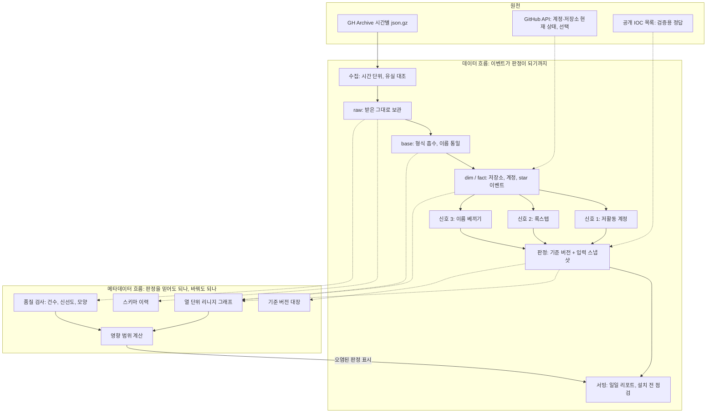

# GH 프로젝트 전체 설계 (v0.3, 2026-11-12)

> **2026-11-17: 이전 설계다.** 문제 정의를 "사용자 분석에서 봇은 노이즈"로 넓힌 새 설계는 `docs/design_overview.md`, 구현 순서는 `docs/implementation_design.md`다. 이 문서의 원천 실측(4.1절)과 결정 D1~D16은 참고로 남긴다.

> 이 문서는 위에서 아래로 쪼개 내려가기 위한 지도다. 각 칸의 세부는 일부러 비워 뒀다.
> 세부는 해당 단계에 들어갈 때 이론을 공부한 뒤 내가 직접 정하고, 9절 결정 목록에 기록한다.
>
> 표기: `[확정]` 내가 이미 정한 것 / `[결정]` Claude가 근거(9.1절)와 함께 정했고 내가 따르기로 한 것 / `[제안]` Claude가 낸 기본값, 내가 아직 안 고름 / `[열림]` 선택지만 있음 / `[측정]` 실행해서 얻어야 하는 값 / `[확인]` 사실 확인 필요
>
> v0.2 (2026-11-12): D1~D12 결정, D13(분석 기간) 추가, 원천 상태 사실 확인 반영.
> v0.3 (2026-11-12): 당근 데이터가치화팀 글 5편과 대조. 1.1절(관점) 추가. 당근 구현을 따라 들여왔다가 이 프로젝트의 이유가 없는 것은 되돌렸다. D14(리니지 입력), D15(깨진 줄), D16(기준 대장 항목과 응답 v1.1) 추가. 원천 건강도 실측(4.1절 표), star 포착률 교차 검증, D13 확정(2025-04), 신호의 관측 손실 원칙(4.6절) 반영.

---

## 1. 한 장 요약

**한 줄 정의**
GitHub 공개 이벤트(GH Archive)에서 AI 스킬·MCP 저장소의 **위조된 인기 신호**를 탐지하고, 그 판정을 **믿어도 되는지와 바꿔도 되는지**까지 플랫폼이 답한다.

**왜 하나** `[확정]`
- 스킬·MCP는 GitHub에서 찾아 바로 설치하고, star 수가 신뢰 신호로 쓰인다.
- 공격자는 봇으로 star를 싸게 위조해 유명한 척하고 악성코드를 퍼뜨린다 (2026년 FakeGit / AgentBaiting 사례).
- 속는 대상이 사람만이 아니라 AI 에이전트다. 그래서 방어도 에이전트가 설치 전에 물어볼 수 있는 형태여야 한다.

**주인공 축** `[확정: 유연성]`
- 주인공: **변경에 강한 구조** (열 단위 관계 파악, 되돌릴 수 있는 버전, 서로 독립인 구조)
- 조연: **엔진 지식**. 유연성을 고른 대가(스캔량, 셔플, 저장량)를 엔진 수준에서 설명하는 근거로만 쓴다.
- 탐지 자체는 주인공이 아니다. 탐지는 "계속 바뀌는 요구사항"을 만들어 주는 소비자다. 공격 방식이 바뀌면 판정 기준이 바뀌고, 그때 플랫폼이 버티는지가 이 프로젝트의 본체다.

**증명 방식**
"유연하게 만들었다"고 말하지 않는다. 7절의 변경 시나리오 4개를 일부러 실행하고 **변경 비용을 잰 값**으로 말한다.

**목표 조직**: 당근 데이터가치화팀 Software Engineer, Data `[확정]`. 평가 기준은 데이터 플랫폼 3년차.

### 1.1 관점: 같은 시선, 다른 자리 `[결정]`

이 프로젝트가 보여 줄 것은 "당근처럼 만들었다"가 아니다. **같은 문제를 같은 눈으로 보고, 내 자리에서 스스로 판단해 한 걸음 더 갔다**는 것이다. 구현은 내 상황에서 같은 이유가 나올 때만 같게 고르고, 이유가 다르면 다르게 고르고 그 이유를 적는다.

**같은 시선**
- 당근 데이터가치화팀의 2026년 글은 이렇게 말한다. AI가 바로 답하는 시대일수록, 그 답이 믿을 만하게 만들어지는 기반(정의, 리니지, 품질 상태)이 데이터 조직의 일이 된다.
- 이 프로젝트도 같은 질문에서 출발한다. **"에이전트가 내 데이터로 판단할 때, 그 판단을 믿어도 되는 조건을 플랫폼이 스스로 말할 수 있나?"**

**다른 자리, 그리고 한 걸음 더**
1. **통제할 수 없는 원천.**
   - 당근은 사용자 행동 로그를 직접 수집한다. 나는 남이 수집한 원천(GH Archive)에 기댄다.
   - 실제로 매달 한 시간씩 표본을 재 보니, 깨진 줄은 0건인데 전체 이벤트 중 WatchEvent 비율이 3.5%(2025-03)에서 1.6%(2026-01)로 줄었다. 원인은 아직 확인하지 못했다(4.1절).
   - 오류 없이 조용히 무너지는 원천에서 "모르겠다"를 정확히 말하는 것이 이 프로젝트의 핵심 문제다.
2. **"답 없음"의 범위를 넓힌다.**
   - 당근 data-mcp는 권한 밖 질문에 답을 지어내지 않는다. "답이 없는 것이 틀린 답보다 안전하다"는 원칙이다.
   - 나는 같은 원칙을 데이터 품질로 넓힌다. 판정이 기대는 데이터가 오염되면 신호가 안 걸렸어도 `cannot_assess`로 답한다(4.8절).
3. **신뢰 장치 자체를 검증한다.**
   - 당근 리니지 글은 SQL 파싱이 생각보다 복잡해서 주요 패턴부터 커버리지를 쌓는다고 한다.
   - 나는 리니지가 예측한 영향 범위가 실제로 달라진 범위와 같은지 숫자로 잰다(S3). 리니지가 틀리면 오염 표시도 틀리기 때문이다.
4. **기준을 바꿔도 되는지 답한다.**
   - 공격 방식이 바뀌면 판정 기준이 바뀐다. 기준을 버전으로 남기고, 과거 판정을 재현하고, 틀리면 되돌린다(S4).

**소비자가 다르다.** 당근 플랫폼의 소비자는 사내 구성원과 그들의 AI 에이전트다. 이 프로젝트의 소비자는 설치 여부를 정하는 외부 에이전트다. 틀린 "문제 없음" 한 번이 악성 코드 설치로 이어진다. 그래서 위 2번을 계약(`allOf`)으로 강제한다.

**면접에서 할 말의 형태**: "당근은 이 조건이라 A를 골랐다. 내 조건은 이렇게 달라서 B를 골랐다. 그 결과 이만큼 재 봤다."

---

## 2. 범위

### 만드는 것
1. 시간 단위 수집과 원본 보관 (유실 대조, 재처리 가능)
2. 시기별 이벤트 형식 차이를 한 계층(base)에서 흡수
3. 신호 계산 (신호마다 독립)
4. 판정 (기준 버전과 입력 스냅샷이 묶인 결과)
5. 메타데이터: 스키마 이력, 열 단위 리니지, 품질 검사, 기준 버전 대장
6. 서빙: 일일 의심 저장소 리포트 + 설치 전 점검 창구

### 안 만드는 것 (필요가 측정으로 드러나기 전까지)
| 안 만드는 것 | 이유 | 다시 꺼내는 조건 |
|---|---|---|
| 스트리밍 수집 (Pub/Sub, Kafka) | 원천이 시간 단위 파일이라 최소 지연이 1시간 이상이다. 재생해서 흘리는 스트림은 가짜 실시간이다 | 원천이 실시간 API로 바뀔 때 |
| ML 모델, 온라인 서빙 | 탐지는 알고리즘으로 충분하고, 깊이 축이 둘이 된다 | 규칙으로 못 잡는 패턴이 실측으로 나올 때 |
| 웹 UI, 그래프 시각화 | 소비자는 리포트와 조회 창구면 된다 | 실제 사용자가 요청할 때 |
| k8s, 멀티 노드 클러스터 | 한 대에서 한계를 먼저 잰다 | 한 대 한계를 수치로 넘었을 때 |
| 코드 악성 여부 분석 | 이 프로젝트는 "인기가 위조됐다"만 본다 | 범위 밖 (한계로 명시) |
| PII 태그 전파, TPC-DS 리니지 벤치마크 | 좋은 확장이지만 본체가 선 뒤의 일 | 6단계 이후 여력이 있을 때 |

---

## 3. 전체 구조

읽는 법
- 왼쪽 실선은 데이터가 흐르는 길, 점선은 그 흐름이 남기는 흔적이다.
- 핵심 연결은 `품질 실패 → 리니지 하류 탐색 → 그날 판정에 "믿지 말 것" 표시`다. 이게 없으면 탐지기일 뿐이고, 있으면 데이터 플랫폼이다.

---

## 4. 계층별 설계

각 계층은 "책임 / 입력과 출력 / 바뀔 때 번지는 범위 / 열린 결정 / 병목 예상 지점"만 적는다. 구현 방법은 단계에 들어가서 정한다.

### 4.1 원천
- GH Archive: 시간마다 파일 하나, 그 시간의 공개 이벤트 전체 `[확인: 파일 주소 규칙, 누락 시 응답]`
- 쓰는 이벤트: WatchEvent(star), ForkEvent, CreateEvent, ReleaseEvent 중심 `[제안]`
- 알아야 할 원천의 성질
  - star 취소는 기록되지 않는다 `[확인]`. 지워진 가짜 star도 계속 보인다.
  - 계정 생성일, 저장소 삭제 여부는 이벤트에 없다 `[확인]`. 필요하면 GitHub API로 보강한다.
  - 2025년 10월에 이벤트 payload 형식이 바뀌었다. 확인된 내용은 다음과 같다(출처: CodePulse 실측, gharchive 이슈 #326, 2026-11-12 기준).
    - GitHub Events API의 payload 축소가 2025-10-07에 적용됐고, GH Archive에서는 10-08~09에 급변했다.
    - PullRequestEvent의 pull_request 필드가 48개에서 5개로 줄었다. PushEvent의 commits도 사라졌다는 보고가 있다(미검증).
    - `actor.login`, `created_at`은 모든 이벤트에 남아 있다. WatchEvent의 `actor.id`, `actor.login`, `repo.id`, `repo.name`, `created_at`, `payload.action`은 2025-01~2026-11 표본 전 기간에 100% 있다(실측, 아래 표).
    - 2025-10-09~14에는 일부 시간 파일이 부분 수집됐다(시간당 수백 건).
    - **우리가 쓰는 4종은 거의 안 바뀌었다** (실측, 2025-09-15 vs 2025-10-15 12시, `measure_health.py`).
      - Watch: payload 키는 `action` 그대로다. 줄 평균은 510 → 505바이트다.
      - Fork: payload에 `action`이 생겼고, `forkee` 키는 80개에서 79개가 됐다(`public`이 빠짐).
      - Create: payload에 `full_ref`가 생겼다.
      - Release: `release`에 `reactions`가 생겼다(이 표본 시간에서는).
      - 파일이 1/3로 줄어든 것은 Push·PR 쪽 축소 때문이다. 4.4절 분류로 보면 S1은 "필드 추가 → 경고 후 진행"이 대부분이다. 실패 케이스는 하류가 `forkee.public`을 쓸 때만 생긴다.
    - 이 변경이 변경 시나리오 S1의 실제 재료다.
  - **원천 수집량 붕괴** `[실측, 원인 미확인]`
    - 실측 방법: 매달 15일 12시(UTC) 파일 1개씩, 2025-01~2026-10과 2025-10-08, 2025-10-10, 2026-11-11 (2026-11-12, `ingest.py`로 받고 표본 측정 스크립트로 셈).

      | 시간 | 요일 | 전체 | Watch | Watch 비율 | Push | 파일 |
      |---|---|---|---|---|---|---|
      | 2024-06-15 | 토 | 233,373 | 8,462 | 3.6% | 173k | 70MB |
      | 2024-12-15 | 일 | 229,669 | 7,912 | 3.4% | — | 70MB |
      | 2025-01-15 | 수 | 270,553 | 8,977 | 3.3% | 181k | 120MB |
      | 2025-02-15 | 토 | 253,922 | 9,580 | 3.8% | 193k | 77MB |
      | 2025-03-15 | 토 | 265,409 | 9,379 | 3.5% | 203k | 79MB |
      | 2025-04-15 | 화 | 276,552 | 8,916 | 3.2% | 179k | 129MB |
      | 2025-05-15 | 목 | 260,758 | 8,538 | 3.3% | 171k | 120MB |
      | 2025-06-15 | 일 | 167,710 | 5,070 | 3.0% | 123k | 62MB |
      | 2025-07-15 | 화 | 170,233 | 5,366 | 3.2% | 111k | 84MB |
      | 2025-08-15 | 금 | 168,873 | 4,675 | 2.8% | 111k | 82MB |
      | 2025-09-15 | 월 | 174,933 | 4,447 | 2.5% | 117k | 94MB |
      | 2025-10-08 | 수 | 166,407 | 4,532 | 2.7% | 106k | 91MB |
      | 2025-10-10 | 금 | 882 | 8 | — | 682 | 0.2MB |
      | 2025-10-15 | 수 | 156,052 | 2,528 | 1.6% | 117k | 32MB |
      | 2025-11-15 | 토 | 157,410 | 3,519 | 2.2% | 122k | 32MB |
      | 2025-12-15 | 월 | 156,113 | 2,297 | 1.5% | 113k | 34MB |
      | 2026-01-15 | 목 | 153,766 | 2,510 | 1.6% | 116k | 34MB |
      | 2026-02-15 | 일 | 153,474 | 3,264 | 2.1% | 115k | 34MB |
      | 2026-03-15 | 일 | 164,927 | 2,689 | 1.6% | 131k | 32MB |
      | 2026-04-15 | 수 | 156,006 | 872 | 0.56% | 127k | 25MB |
      | 2026-05-15 | 금 | 87,307 | 257 | 0.29% | 73k | 13MB |
      | 2026-06-15 | 월 | 162,822 | 119 | 0.07% | 138k | 22MB |
      | 2026-07-15 | 수 | 169,372 | 41 | 0.02% | 155k | 22MB |
      | 2026-08-15 | 토 | 170,586 | 24 | 0.01% | 167k | 21MB |
      | 2026-09-15 | 화 | 55,822 | 1,158 | 2.1% | 37k | 24MB |
      | 2026-10-15 | 목 | 3,192 | 225 | — | 0 | 3.9MB |
      | 2026-11-11 | 수 | 4,391 | 241 | — | 0 | 3.9MB |

    - 세 번에 걸쳐 무너졌다.
      1. **2025-05 → 06**: 모든 이벤트 종류가 약 35% 함께 줄었다. Watch 비율은 3.0~3.3%로 그대로다. star만 빠진 것이 아니라 수집량 전체가 줄었다고 본다(추정).
      2. **2025-10**: payload 축소(10-07) 직후 Watch만 줄었다. Push와 전체 건수는 그대로인데 Watch 비율이 2.7%(10-08)에서 1.6%(10-15)로 떨어졌다. 10-10은 882건짜리 부분 파일이다.
      3. **2026-04 이후**: WatchEvent가 사실상 사라졌다(872 → 257 → 119 → 41 → 24). Fork와 PR도 같이 줄었지만 Push는 13만~17만 건으로 정상이다. 그런데 2026-09에는 반대로 전체가 5만 6천 건으로 줄고 Watch는 1,158건(2.1%)으로 다시 보였다. 원천의 수집 방식이 그 사이에 또 바뀐 것으로 보인다(추정). 2026-10부터는 Push까지 0이고 시간당 수천 건만 남았다.
      - 무너짐이 한 방향이 아니다. 이벤트 종류마다 따로 사라지고 돌아온다. 그래서 품질 검사는 전체 건수 하나가 아니라 **이벤트 종류별 건수**를 봐야 한다(D10).
    - 필드와 형식은 전 기간 온전하고 깨진 줄도 0이다. 깨진 것은 형식이 아니라 **수집량**이다. 오류 없이 조용히 무너지는 원천이라, 품질 검사가 건수로 잡아야 한다(D10).
    - 한계: 달마다 한 시간 표본이다. 요일과 시간대 차이를 거르지 못했고, 무너진 정확한 날짜는 모른다.
    - 2026-10-27부터 시간당 약 3천 건이라는 이슈 #326은 열려 있고, 2026-11-11까지 메인테이너 답이 없다.
    - **stargazer 조회 제한은 사실이다** (2026-11-12 확인). 로그인한 상태에서도 남의 저장소 `repos/{repo}/stargazers`는 404이고, 내 저장소는 200이다. 그래서 남의 저장소에 star한 계정 목록의 공개 출처는 GH Archive뿐이다. 계정별 `users/{login}/starred`(star 시각 포함)는 아직 공개다.
  - **star 포착률 교차 검증** `[실측]` (2026-11-12)
    - 방법: 시간 파일마다 star한 계정 200명을 뽑는다. 그 계정이 같은 한 시간에 찍은 star를 GitHub API(`users/{login}/starred`, star 시각 포함)에서 받고, 그중 GH Archive에 있는 비율을 저장소 id로 맞춰 센다.
    - 보정: 표본을 GH Archive에서 뽑아서 계정마다 최소 1개는 잡혀 있다. 그래서 한 시간에 2개 이상 찍은 계정만 쓰고, 계정마다 1개를 빼고 센다. 95% 구간은 계정을 다시 뽑는 부트스트랩으로 구한다.

      | 시간 | 포착률 | 95% 구간 | 잘린 이항 최대우도 추정 | 계정 수 |
      |---|---|---|---|---|
      | 2025-04-15 | **0.62** | 0.48–0.73 | 0.71 | 31 |
      | 2025-09-15 | 0.39 | 0.30–0.49 | 0.48 | 41 |
      | 2025-10-15 | 0.10 | 0.05–0.13 | 0.14 | 49 |
      | 2026-01-15 | 0.07 | 0.03–0.12 | 0.11 | 45 |

    - 2025-10 이후 포착률은 2025-04의 약 1/6~1/9이고, 95% 구간이 겹치지 않는다. 위 표의 Watch 비율 하락은 star가 실제로 줄어서가 아니라 **원천이 놓친 것**이다.
    - 2025-09는 중간이다. 2025-06의 1단계 붕괴(전체 수집량 감소)가 star에도 닿았다.
    - **건강한 2025-04에서도 한 시간에 몰아서 찍은 star는 약 30~40%를 놓친다.** 위조 캠페인은 바로 이렇게 몰아 찍는 모양이라, 신호 설계가 이 손실을 전제로 해야 한다(4.6절).
    - 표본 계정의 3~5%는 지금 삭제·정지 상태(API 404)이고, 약 12%는 GH Archive에는 star가 있지만 API에는 없다(나중에 취소한 것으로 본다). 정지된 계정의 star는 GH Archive에만 남는다.
    - 한계: 시간마다 한 시간 표본이고, 여러 개를 찍은 계정이 31~49명이라 구간이 넓다. 손실이 무작위라고 가정했다. 손실이 시간 덩어리째 생기면 포착률이 높게 추정된다.
    - 이 붕괴 때문에 D13(분석 기간)이 생겼다.
- 결정: D5(대상 저장소), D6(계정 나이), D13(분석 기간). 9.1절 참고.

### 4.2 수집
- 책임: 정해진 시간 창의 파일을 빠짐없이, 몇 번 다시 받아도 같은 결과로 가져온다.
- 출력: 시간 파일 + 수집 기록(시간 창, 파일 크기, 줄 수, 체크섬, 수집 시각)
- 유실 대조: 원천 파일 줄 수 = raw 적재 건수. 하루 24개 파일이 다 왔는지.
- 지연: 공격 저장소는 수명이 짧다. 일주일 뒤 탐지는 의미가 없으니 최소 하루, 가능하면 시간 단위 `[결정: D1 시간 단위 수집, 일 단위 판정]`
- 병목 예상: 네트워크 I/O, gzip 해제(단일 스레드, 분할 불가)
- **사건 (2026-11-12, D13 표본 수집 중)**: 연결 4개가 초당 약 4KB씩 50분 넘게 흘렀다. 그런데 소켓 timeout(60초)이 한 번도 걸리지 않았다. timeout은 "60초 동안 0바이트"일 때만 걸려서, 조금씩 오는 연결은 끊지 못한다. 같은 시각 새 연결은 초당 131KB였다(py-spy dump로 4개 스레드가 모두 `SSLSocket.read`에서 대기 중인 것을 확인). 그래서 `ingest.copy_or_stall`을 넣었다. 60초 동안 1MB 미만이면 끊고 새로 연결해 재시도한다. 6단계 운영 기록의 첫 사례다.

### 4.3 raw (원본 보관)
- 책임: 받은 그대로 보관한다. 아무것도 고르지 않고 고치지 않는다. 모든 재처리의 출발점.
- 원칙: raw는 절대 수정하지 않는다. 판정 기준이 바뀌어도 raw에서 다시 만들 수 있어야 한다.
- 결정: D2 `[확정]` 조합(raw는 원본 그대로, base에서 해석), D3 raw는 시간 단위, D4 로컬 raw + BigQuery 적재 구역. 9.1절 참고.
- 병목 예상: JSON 파싱 비용(읽을 때마다 낸다), 작은 파일 개수

### 4.4 base
- 책임: **원천 이름이 우리 이름으로 바뀌는 유일한 지점.** 시기별 형식 차이를 여기서만 흡수한다.
- 규칙: 하류(dim, fact, 신호)는 원천 필드 이름을 모른다. 원천이 바뀌면 base만 고친다.
- 변화 분류 (서울 동네 찾기 P1·P2에서 리허설한 방식 그대로)
  - 새 필드 추가, 안 쓰는 필드 삭제: 경고 후 진행
  - 쓰는 필드 삭제, 뜻 변경: 실패
  - 이름 변경: 버전이 붙은 매핑에 있으면 흡수, 없으면 실패
- 대가: 계층이 하나 늘고, view로 두면 하류가 매번 원천을 다시 읽는다. 물리화하면 저장량과 갱신 비용이 든다 `[결정: D7 일 파티션 증분 table]`
  - 당근은 base를 view로 둔다. 당근 base는 이미 타입이 있는 DB 원천 위에 있고, 이 프로젝트의 base는 JSON 원문을 파싱하는 자리라서 다르게 골랐다(9.1절 #7).
- 깨진 줄 `[결정: D15]`
  - JSON 파싱에 실패한 줄은 버리지 않고 격리 표(`base_rejected_line`)에 원문, 원천 파일, 줄 번호, 오류를 남긴다.
  - 유실 대조식이 `원천 줄 수 = base 건수 + 격리 건수`가 된다. 원천이 내 통제 밖이라, 모든 줄의 행방이 설명돼야 품질 판단을 할 수 있다.
  - 중복 `[측정]`: 같은 이벤트 `id`가 두 시간 파일에 걸치는지 먼저 잰다. 있으면 `id`로 제거하고 대조식에 항을 더한다.
- 공통 필드(`id`, `type`, `actor`, `repo`, `created_at`)는 열로 펼치고, `payload`는 JSON 그대로 둔다. `payload`는 이벤트 종류마다 모양이 다르고, 2025-10처럼 원천 쪽에서 바뀌기 때문이다(S1).

### 4.5 dim / fact
| 표 | 한 행의 뜻 (grain) | 비고 |
|---|---|---|
| `fact_star_event` | 계정 하나가 저장소 하나에 star를 찍은 사건 1건 | 가장 큰 표, 시간 파티션 |
| `fact_repo_event` | fork, create, release 사건 1건 | 신호 보조 |
| `dim_repo` | 저장소 1개 | 이름, 소유자, 처음 본 시각, 대상 여부(스킬·MCP) |
| `dim_actor` | 계정 1개 | 처음 본 시각, 활동 요약 |

- 처리 단위: 시간(또는 일) 파티션을 통째로 지우고 다시 넣는다 (멱등)
- 병목 예상: `fact_star_event`의 저장소별 쏠림. 인기 저장소 몇 개에 이벤트가 몰린다.

### 4.6 신호 (서로 독립)
| 신호 | 보는 것 | 알고리즘 성격 | 예상 병목 |
|---|---|---|---|
| S-A 저활동 계정 | star만 찍고 다른 활동이 거의 없는 계정의 비율 | 그룹 집계 | 계정별 전체 기간 집계 |
| S-B 록스텝 | 여러 계정이 같은 저장소들에 비슷한 시간대에 몰려 star | 이분 그래프, 시간 창, 묶음 찾기 | **계정 쌍 생성이 인기 저장소에서 폭발한다. 이 프로젝트에서 Spark와 스큐를 다루는 유일하고 정당한 자리** |
| S-C 이름 베끼기 | 유명 저장소와 거의 같은 이름 | 편집 거리 | 전체 쌍 비교는 O(n²), 비교 대상을 줄이는 방법이 핵심 |

- **신호 계약** `[제안]`: 모든 신호는 같은 모양으로만 내보낸다.
  `(repo_id, signal_name, score, evidence, window, rule_version, computed_at)`
- 판정은 이 계약만 읽는다. 신호 내부는 판정을 모른다.
- **관측 손실을 전제로 한다** `[결정]` (4.1절 교차 검증)
  - 건강한 구간에서도 몰아 찍은 star의 약 30~40%가 원천에 없다. 그래서 신호의 건수는 실제 건수가 아니라 **관측된 건수**다.
  - 임계값은 절대 건수로 두지 않는다. 같은 구간 안의 분포에서 상대적으로 정한다(예: 구간 안 저장소들의 상위 분위수).
  - 응답의 `evidence` 숫자는 관측값이라고 계약 설명에 밝힌다(4.8절).
  - S-B(록스텝)는 묶음의 일부만 보인다. 묶음 크기를 그대로 믿지 말고, "관측된 묶음이 이 정도면 실제는 그 이상"으로 읽는다.
- 얻는 것: 신호를 더해도 기존 코드를 안 고친다. 한 신호가 실패해도 나머지로 판정이 나간다.
- 내는 것: 신호끼리 중간 결과를 못 나눠 써서 같은 스캔이 반복될 수 있다 `[측정]`

### 4.7 판정
- 책임: 신호들을 정해진 기준으로 합쳐 저장소별 신뢰 지표를 낸다.
- 출력 한 행: `(repo_id, verdict, 근거가 된 신호들, rule_version, input_snapshot, data_health, decided_at)`
- 원칙
  - 판정은 "악성"이 아니라 **"의심 신호"**로만 표현한다.
  - 같은 입력 스냅샷 + 같은 기준 버전 = 같은 판정 (재현 가능)
  - 새 기준은 별도 버전으로 먼저 만들고, 이전 버전과 판정이 달라진 저장소만 뽑아 검토한 뒤 교체한다.
  - 틀렸으면 이전 버전으로 되돌린다.
- 결정: D8 입력 매니페스트(raw 파일 체크섬 + 코드 버전 + 기준 버전), 교체는 쓰기-검사-공개(WAP). D12 규칙 조합. 9.1절 참고.
- 기준 버전 대장의 한 행 `[결정: D16]`: `(rule_version, signal_name, definition, logic_ref, created_at, supersedes)`.
  - `definition`은 사람이 읽는 한 문장이고, `logic_ref`는 그 규칙을 구현한 dbt 모델과 git sha다.
  - 응답 v1.1의 `definition`이 이 대장에서 나온다. 기준을 되돌리면(S4) 응답의 설명도 같이 되돌아간다.

### 4.8 서빙
- 일일 의심 저장소 리포트 (파일)
- 설치 전 점검 창구: 저장소 주소를 넣으면 신뢰 지표, 근거, **그 판정의 데이터 상태**를 돌려준다 `[결정: D9 MCP]`
- 응답 계약을 먼저 정하고 내부를 만든다 (서울 동네 찾기의 상품 계약과 같은 방식)
- **응답 계약 v1.0** `[결정]` (2026-11-12)
  - 파일: `contract/check_popularity_signals.json`. 이 파일이 MCP 도구 정의 자체다(이름, 설명, annotations, inputSchema, outputSchema). 서버는 이 파일을 그대로 읽어 등록한다.
  - 예시: `contract/examples.json`. 검사: `test_contract.py`.
  - 도구 이름은 `check_popularity_signals`다. "신뢰도 점검"이 아니라 "인기 신호 점검"이라고 이름 붙여서, 코드 악성 여부는 보지 않는다는 한계를 이름에 담는다.
  - 응답 필드: `verdict`, `recommendation`, `summary`, `signals[]`, `data_health`, `provenance`, `contract_version`.
  - 판정(verdict) 4종
    - `suspicious`: 신호가 하나 이상 걸렸다.
    - `no_signal`: 계산했는데 아무 신호도 안 걸렸다. **안전하다는 뜻이 아니다.**
    - `insufficient_data`: 추적 대상이지만 활동이 너무 적어 판단할 수 없다.
    - `not_tracked`: 추적 대상 밖이거나 본 적이 없다.
  - 권고(recommendation)는 판정과 데이터 상태로 정해진다.

    | 판정 | 데이터 ok / degraded | 데이터 untrusted |
    |---|---|---|
    | suspicious | review_before_install | review_before_install |
    | no_signal | no_known_issue | **cannot_assess** |
    | insufficient_data, not_tracked | cannot_assess | cannot_assess |

  - **핵심 규칙: 품질 실패가 리니지를 타고 이 판정의 신호에 닿으면(`untrusted`), "문제 없음"이라고 말하지 않는다.** 3절의 "오염된 판정 표시"를 계약으로 강제한 것이다. 이 규칙은 스키마의 `allOf`에 있어서, 내부 구현이 어긋나면 검사가 실패한다.
  - `data_health.coverage.window_end`가 "이 시각까지의 데이터"를 뜻한다. 분석이 과거 구간 리플레이라서(D13) 에이전트가 최신 정보로 오해하지 않게 한다.
  - 신호 이름과 evidence는 열어 둔다. 신호를 더해도 계약을 바꾸지 않는다(S2). 반대로 모르는 최상위 필드는 거부한다. 필드를 추가하면 minor, 필드를 빼거나 뜻을 바꾸면 major 버전을 올린다.
  - 입력이 잘못되면(owner/name이나 GitHub 주소가 아니면) MCP 실행 오류(`isError`)로 돌려준다. 그 밖의 경우는 전부 정상 응답이고, 판단할 수 없는 경우도 정상 응답으로 판정 종류로 표현한다.
  - 같은 `input_snapshot` + `rule_version` + `code_version`이면 같은 응답이 나와야 한다(D8).
- **응답 계약 v1.1** `[결정: D16]` (2026-11-12 계약 파일·예시·검사 반영, 필드만 더하므로 minor)
  - `signals[]`에 `definition`(규칙 한 문장)을 더한다. 값은 기준 버전 대장(4.7절)에서 온다.
  - `provenance`에 `sources`(이 판정의 근거가 된 표·열 목록)를 더한다. 값은 리니지(4.9절)에서 거꾸로 올라가 얻는다.
  - 왜 `definition`: 에이전트는 사용자에게 "왜 의심인지"를 전해야 한다. `rule_version` 문자열만으로는 그 버전이 무엇을 보는지 알 수 없다.
  - 왜 `sources`: 이 판정이 어느 열에 기대는지가 오염 표시(`untrusted`)를 판단하는 입력이다. 응답에 함께 내보내면, 품질 문제가 왜 이 판정에 닿았는지를 받는 쪽도 따라갈 수 있다.
  - 오너 필드는 넣지 않는다. 혼자 운영하는 프로젝트라 모든 규칙의 오너가 같아서 정보가 없다.
  - `evidence`의 숫자는 관측값이다. 계약의 필드 설명에 "원천이 일부를 놓치므로 실제는 이 이상"이라고 적었다(4.6절). 필드 모양은 그대로라 버전은 올리지 않는다.

### 4.9 메타데이터 (깊이 축)
| 장치 | 답하는 질문 | 유연성 축 |
|---|---|---|
| 스키마 이력 | 원천 모양이 언제 바뀌었나 | 관계 파악 |
| 품질 검사 | 오늘 데이터가 평소와 같은가 (건수, 신선도, 모양) | 신뢰 |
| 열 단위 리니지 | 이 열을 바꾸면 하류의 무엇이 달라지나 | 관계 파악 |
| 영향 범위 계산 | 이 표가 깨졌으면 어느 판정을 믿으면 안 되나 | 관계 파악 |
| 기준 버전 대장 | 어느 버전이 어느 판정을 만들었나 | 되돌릴 수 있는 버전 |

- 리니지 추출 `[결정: D14]`: dbt 컴파일 SQL을 sqlglot으로 파싱해 `(상류 열, 하류 열, 변환 종류)` 간선을 쌓는다.
  - 실행 로그(BigQuery `INFORMATION_SCHEMA.JOBS`)가 아니라 컴파일 SQL을 고른 이유는 S3 때문이다. 변경 **전에** 영향 범위를 예측하려면, 아직 실행하지 않은 변경 SQL에서도 간선을 뽑을 수 있어야 한다. 실행 로그에는 이미 돈 쿼리만 남는다(9.1절 #14).
- 영향 범위: 간선 표 위의 그래프 탐색(BFS).
- **한계를 미리 정한다**: Spark로 도는 구간(S-B)은 SQL 파싱으로 열 단위를 못 뽑는다. 그 구간은 입출력 표를 선언으로 적는 표 단위 리니지로 둔다. 전부 열 단위라고 말하지 않는다.
- 리니지의 승부처는 규모가 아니라 **정확성**이다. 내 표는 수십 개라 LINE·당근 같은 규모 문제가 생기지 않는다. "리니지가 예측한 영향 범위 = 실제로 달라진 범위"를 변경 시나리오 S3로 검증한다.

---

## 5. 기술 선택

| 자리 | 기본값 | 근거 | 상태 |
|---|---|---|---|
| 오케스트레이션 | Airflow | 목표 팀 스택, 4주 공부와 겹침 | `[결정]` |
| dbt 실행 연결 | Airflow task 하나에서 `dbt build --vars target_date`, 날짜별 재실행은 dynamic task mapping | 6단계 리플레이 운영은 "날짜 하나를 다시 흘린다"의 반복이라, 날짜를 인자로 받는 실행 단위가 필요하다. 모델이 수십 개라 모델별 task 분리(astronomer-cosmos 등)는 얻는 것이 적다 | `[결정]` |
| 웨어하우스 | BigQuery (base부터) | 목표 팀이 BigQuery 하나로 운영 | `[결정: D4]` |
| 변환 | dbt (base, dim, fact, signal, verdict) | 목표 팀 구조, 리니지 입력이 SQL로 남음 | `[결정]` |
| 무거운 처리 | Spark, **S-B와 장기 백필에만** | 한 대 도구(DuckDB 등)로 먼저 재고 넘는 지점에서만 쓴다 | `[결정]` |
| 리니지 파싱 | sqlglot, 입력은 dbt 컴파일 SQL | 서울 동네 찾기 P4에서 리허설, 변경 전 예측(S3)에 필요 | `[결정: D14]` |
| raw 보관 | 로컬 디스크 (원본 json.gz 그대로) | 무료 저장 한도(BigQuery 10GB, GCS 5GB)로는 한 달 원본을 못 담는다 | `[결정: D4]` |

**비용과 규모의 원칙**
- 무료 사용량 안에서 한다. 파티션 필터 강제와 dry-run 스캔 가드를 처음부터 넣는다.
  - 무료 한도는 쿼리 월 1TiB, 저장 10GiB다(2026-11-12 확인).
  - **샌드박스(결제 계정 없음)는 못 쓴다** (2026-11-12 공식 문서 확인).
    - 샌드박스에서는 표와 파티션이 60일 뒤 만료된다. 파티션 만료는 파티션 날짜 기준으로 계산해서, 2025년 `dt` 파티션은 올리자마자 만료된다(두 문서를 합친 추론이다).
    - 샌드박스는 DML이 안 된다. 그래서 D7의 insert_overwrite(MERGE)를 쓸 수 없다.
    - 그래서 결제 계정을 연결한 프로젝트를 쓰고 예산 알림을 건다. 무료 사용량은 결제 계정이 있어도 적용된다.
    - 출처: [BigQuery 샌드박스](https://docs.cloud.google.com/bigquery/docs/sandbox), [파티션 표 관리](https://docs.cloud.google.com/bigquery/docs/managing-partitioned-tables)
- 기간은 **한 달로 시작**한다 `[제안]`. raw는 전체 이벤트, 웨어하우스에는 쓰는 이벤트만 올린다.
- 한 달 원본 크기, star 이벤트 건수, 인기 저장소 쏠림 정도 `[측정: 1단계에서 가장 먼저]`
- "왜 Spark인가"는 말이 아니라 같은 작업을 한 대 도구와 Spark로 크기별로 잰 그래프 한 장으로 답한다.

---

## 6. 쪼개는 지도 (위에서 아래로) + 이론 지도 (아래에서 위로)

프로젝트는 왼쪽 열에서 오른쪽으로 쪼개고, 이론은 오른쪽 열을 먼저 공부한 뒤 왼쪽으로 올라온다.
각 단계는 **끝 조건을 통과해야** 다음으로 간다.

| 단계 | 쪼갠 조각 | 끝 조건 | 먼저 공부할 이론 (아래에서 위로) | 코테 연결 |
|---|---|---|---|---|
| **0. 문제와 범위** | 문제 정의, 한계, 대상 저장소 기준(D5) | README 첫 문단과 한계 절을 내 말로 씀 | 데이터 생명주기(생성, 수집, 저장, 변환, 서빙), 소비자에서 거꾸로 설계 | 없음 |
| **1. 관통 뼈대** | 하루치 수집 → raw → base → fact → 신호 1개(S-A) → 판정 → 리포트 | 하루치가 끝에서 끝까지 한 번 돈다. 원본 크기 실측 완료 | 파일 형식(행 기반 vs 열 기반), 압축과 분할 가능성, 파티셔닝, 멱등성 | 해시맵 집계 |
| **2. 원본과 base 견고화** | 유실 대조, 재수집, 스키마 이력, 시기별 형식 흡수, 변화 분류 | 2025-10 전후 데이터를 넣어도 base만 고치고 하류 수정 0 (S1) | 스키마 온 리드/라이트, 스키마 진화, 직렬화, 정확히 한 번 vs 최소 한 번 | 문자열 파싱, 정렬 |
| **3. 신호 확장** | S-B 록스텝, S-C 이름 베끼기, 신호 계약 | 신호 2개를 기존 코드 수정 없이 추가 (S2). S-B의 한 대 한계와 Spark 비교 그래프 | 조인 알고리즘(해시, 소트 머지), 셔플, 스큐, AQE, 메모리 모델, 스필 | 슬라이딩 윈도우, Union-Find, 편집 거리(DP), 후보 줄이기(해싱) |
| **4. 메타데이터** | 리니지 추출, 간선 표, 영향 범위 계산, 품질 실패 → 판정 오염 표시 | 열 하나를 바꾸기 전 예측 범위 = 실제 달라진 범위 (S3) | SQL 파싱(토큰, AST, 스코프), 논리 계획, Catalyst 분석 단계와의 대응 | 그래프 BFS/DFS, 위상 정렬 |
| **5. 기준 버전과 되돌리기** | 버전 대장, 그림자 빌드, 판정 차이 검토, 교체, 되돌리기 | 과거 판정을 그대로 재현. 되돌리기 1회 실제 수행 (S4) | 스냅샷과 타임 트래블, 불변 데이터, 쓰기 후 교체(write-audit-publish) | 없음 |
| **6. 공개와 운영** | 조회 창구 공개, 2~4주 스케줄 운영, 운영 기록, IOC 대조 | 운영 중 실제로 생긴 사건(누락 파일, 지연 등)과 대처가 기록됨 | 관측성(지표, 로그), SLA/SLO, 백필 전략 | 없음 |

### 6.1 고민 지점 (내가 직접 돌려 보는 곳)

기초 구현은 Claude가 한다. 아래 지점에서는 Claude가 **실험 키트**까지만 만든다. 키트는 A 구현, 바꿀 손잡이, 볼 계기(자원 사용량, 내부 구조)로 이루어진다. 실행하고, 관찰하고, 해결책을 고르는 건 내가 한다.

| 번호 | 단계 | 이 장점을 원해서 A를 골랐다 | 예상 문제 (실행 전 가설) | 볼 계기 | 관련 |
|---|---|---|---|---|---|
| G1 | 1 | raw를 json.gz 그대로 둔다. 언제든 다시 처리할 수 있다 | 다시 처리할 때마다 gzip 해제와 JSON 파싱을 한다. 코어 1개만 바쁘고, 스레드를 늘려도 안 빨라질 수 있다(GIL) | 코어별 CPU, 파일당 처리 시간, py-spy 프로파일 | D2, D7. **완료**: 스레드 0.92배, 프로세스 8개 4.8배, 메모리 8.7배. `experiments/g1_reparse/README.md` |
| G2 | 2 | base를 view로 둔다. 저장이 0이고 단순하다 | 하류 쿼리마다 JSON 원문을 다시 스캔한다 | BigQuery dry-run 스캔 바이트, 쿼리 시간 | D7. **키트 준비됨**(GCP 프로젝트 필요): `experiments/g2_base_view/README.md` |
| G3 | 3 | S-B는 계정 쌍 단위로 본다. 묶음을 정확히 찾는다 | 인기 저장소에서 쌍 수가 k²로 폭발한다. 메모리가 터지거나 한 태스크만 오래 걸린다(스큐) | 저장소별 star 분포, 쌍 수, 피크 메모리, Spark UI 태스크 시간 분포와 스필 | S-B |
| G4 | 3 | S-C는 편집 거리로 본다. 왜 걸렸는지 설명하기 쉽다 | 전체 쌍 비교가 O(n²)이다 | 비교 횟수, 시간, 후보를 줄인 뒤 놓친 쌍(재현율) | S-C |
| G5 | 3 | 신호는 서로 독립이다. 신호를 더해도 기존 코드는 0줄 바뀐다 | 신호마다 같은 fact를 다시 스캔한다 | 신호별 스캔 바이트 합 | S2 |
| G6 | 5 | 입력은 매니페스트로만 남긴다. 저장 없이 재현한다 | 재현할 때마다 다시 계산해서 시간이 든다 | 재계산 시간 | D8, S4 |

규칙
- 예상 문제는 **실행 전에** 적는다. 키트는 답을 주지 않는다. 막히면 Claude에게 힌트를 요청한다.
- 예상한 문제가 실제로 안 나오면 안 나왔다고 적는다. 지어낸 문제는 면접에서 숫자를 두 번만 물어도 무너진다. "재 봤더니 문제가 안 돼서 안 바꿨다"도 좋은 기록이다.
- 기록 형식(서사): **[장점]을 원해서 [A]를 썼다 → 돌려 보니 [숫자]만큼 [문제]가 생겼다 → [B]로 바꿨다 → [숫자]로 줄었고 [장점]은 그대로다 → 대가로 [C]를 냈다.** 마지막 줄의 대가를 빼지 않는다. 해결책에도 대가가 있다.

**깊이를 두는 곳**: 3단계의 S-B(엔진), 4·5단계(유연성). 나머지는 얇게 동작만.
**시간이 모자라면 자르는 순서**: S-C → 6단계의 공개 창구(리포트만 남김) → S-B의 Spark 비교. **4·5단계는 자르지 않는다.** 주인공이기 때문이다.

---

## 7. 변경 시나리오 (이 프로젝트의 증거)

각 시나리오는 실행 전에 "지금" 칸을 먼저 재고, 구조를 만든 뒤 다시 잰다.

| 번호 | 일부러 일으키는 변화 | 재는 것 | 통과 기준 |
|---|---|---|---|
| S1 원천이 바뀐다 | 2025-10 형식 변경 전후 데이터를 같이 넣는다 | 고친 파일 수, 고친 표 수, 멈춘 범위 | base 안에서 끝나고 하류 수정 0 |
| S2 요구사항이 늘어난다 | 신호를 하나 더한다 | 고친 기존 파일 수, 수집·raw를 건드렸는지 | 기존 코드 수정 0, 판정은 계약만 읽음 |
| S3 열이 바뀐다 | fact의 열 하나를 바꾼다 | 리니지가 예측한 하류 열 목록 vs 실제 전후 비교로 달라진 열 | 두 목록이 일치, 범위 밖은 전후 동일 |
| S4 되돌린다 | 판정 기준을 이전 버전으로 되돌린다 | 과거 판정이 재현되는지, 다시 계산에 걸린 시간 | 이전 판정과 완전히 같음 |

기록 형식: "고쳤다"가 아니라 **"바꾸기 전 변경 비용은 이만큼, 구조를 바꾼 뒤 이만큼. 그 대가로 낸 것은 이것"**.

---

## 8. 한계와 위험 (README에 같이 적는다)

**탐지의 한계**
- star를 빌려오는 공격(진짜 인기 저장소에 PR을 병합시켜 신뢰를 물려받는 방식)은 못 잡는다.
- 코드가 악성인지는 판단하지 않는다.
- 정답 데이터가 얕다. 공개 IOC 목록과 대조하는 수준이고, 정밀도를 통계로 주장할 수 없다.
- 원천이 star를 다 담지 않는다. 건강한 구간에서도 한 시간에 몰아 찍은 star의 30~40%가 없다(4.1절 교차 검증). 신호의 건수는 관측값이고, 실제는 그 이상이다.
- 공개할 때 특정 계정·저장소를 악성이라고 단정하지 않는다.

**원천의 위험** (2026-11-12 확인, 4.1절)
- GH Archive 수집량은 2025-06, 2025-10, 2026-04 세 번에 걸쳐 무너졌다. WatchEvent는 2026-08에 시간당 24건이었다가 2026-09에 1,158건으로 다시 보였고, 2026-10-27부터는 원천 전체가 거의 비어 있다(4.1절 표). 원천이 회복되지 않으면 "최근 공격을 하루 안에 잡는다"는 실시간성 주장은 할 수 없다.
- GitHub의 stargazer 목록이 저장소 관리자 전용이 됐다(확인). 남의 저장소의 star 계정 목록을 얻을 공개 경로가 GH Archive 말고는 없어서, 원천이 무너진 뒤의 기간은 다른 데서 메울 수 없다.
- 대응: 분석은 원천이 건강했던 과거 구간 한 달로 한다(D13). 6단계 운영은 그 구간을 시간 단위로 다시 흘리는 리플레이 운영이다. 이건 실시간 운영이라고 부르지 않는다.
- 이 원천 붕괴는 품질 검사(D10)가 잡아야 하는 실제 사건이다. 숨기지 않고 "플랫폼이 원천 붕괴를 어떻게 감지했나"의 사례로 쓴다.

**3년차 기준으로 본 이 설계의 약점**
1. **규모가 한 사람 것이다.** 표 수십 개, 사용자 0명에서는 플랫폼다운 문제가 저절로 생기지 않는다. 그래서 변경 시나리오를 일부러 만든다. 이걸 "운영 경험"이라고 부르지 않는다.
2. **조각이 많다.** 수집, 신호 3개, 리니지, 버전, 서빙을 혼자 다 깊게 하면 전부 튜토리얼 수준이 된다. 6절의 자르는 순서를 지킨다.
3. **목표 팀 글을 따라 한 것처럼 보일 수 있다.** 대응은 1.1절의 원칙이다. 당근과 같은 도구(BigQuery, dbt, Airflow, sqlglot)를 쓰더라도, 고른 이유는 이 프로젝트의 조건에서 나와야 한다. 조건이 다른 곳(리니지 입력 D14, base 물리화 D7, 리니지 갱신 주기 D11)에서는 다르게 골랐고, 그 이유를 9.1절에 적었다.
4. **두 엔진에 걸친 리니지는 반쪽이다.** Spark 구간은 표 단위다. 숨기지 않는다.
5. **라이브 코딩은 이 프로젝트가 해결해 주지 않는다.** 코테는 별도로 계속 간다.

---

## 9. 결정 목록

정할 때마다 세 줄로 기록한다: **무엇을 정했나 / 대안은 뭐였나 / 왜 이걸 골랐고 무엇을 냈나.**

| 번호 | 결정 | 고른 것 | 상태 | 정하는 단계 |
|---|---|---|---|---|
| D0 | 프로젝트 목적 | 위조 star 탐지로 스킬·MCP 공격 방지 | `[확정]` | 0 |
| D0-1 | 주인공 축 | 유연성 (엔진 지식은 근거) | `[확정]` | 0 |
| D1 | 수집 주기 | 시간 단위 마이크로배치 수집, 일 단위 판정 | `[결정]` | 1 |
| D2 | raw 구조 | 조합: raw는 원본 그대로(온 리드), base에서 해석(온 라이트) | `[확정]` | 1 |
| D3 | 파티션 크기 | raw는 시간(원천 파일 1개), 웨어하우스는 일 + repo_id 클러스터링 | `[결정]` | 1 |
| D4 | 보관·실행 위치 | 로컬 raw 전체 + BigQuery 적재 구역(쓰는 이벤트만) + dbt | `[결정]` | 1 |
| D5 | 대상 저장소 기준 | 키워드 v1(핵심 5종, 토큰 매칭, 버전 관리) 1차, 유사도는 신호 S-C로 | `[결정, 2025-11 이후 재측정 후 확정]` | 0 |
| D6 | 계정 나이 출처 | GH Archive 처음 본 시각(하한) + 의심 저장소 계정만 API 보강 | `[결정]` | 1 |
| D7 | base 물리화 | 일 파티션 증분 table (static insert_overwrite) | `[결정]` | 2 |
| D8 | 입력 스냅샷 방식 | 매니페스트(raw 체크섬 + git sha + rule_version), 교체는 WAP | `[결정]` | 5 |
| D9 | 서빙 형태 | MCP (응답 계약 먼저) + 일일 리포트 파일 | `[결정]` | 6 |
| D10 | "평소와 다르다" 기준 | 불변 조건은 고정 임계, 건수는 같은 요일·시간 기준선 대비 + 장기 하한 | `[결정]` | 4 |
| D11 | 리니지 갱신 주기 | 변환 실행마다 | `[결정]` | 4 |
| D12 | 판정 합치는 방식 | 규칙 조합 | `[결정]` | 5 |
| D13 | 분석 기간 | 2025-04 (건강한 구간 2025-01~05 안), S1 재료는 2025-10-08·15 따로 | `[결정]` | 1 |
| D14 | 리니지 입력 | dbt 컴파일 SQL (실행 로그 아님) | `[결정]` | 4 |
| D15 | 깨진 줄·중복 | 깨진 줄은 격리 표에 보관, 중복은 잰 뒤 결정 | `[결정, 중복은 측정 후]` | 2 |
| D16 | 기준 대장 항목, 응답 v1.1 | 정의·로직을 대장에 두고 응답에 정의 노출, 근거 표·열 반환 | `[결정]` | 5 |

### 9.1 결정 기록

형식: **정한 것 / 대안 / 왜, 그리고 낸 것**. 근거 출처는 각 기록 끝에 적는다.

**#1 D1 수집 주기: 시간 단위 마이크로배치, 판정은 일 단위**
- 대안: 일 배치, 스트림(Pub/Sub, Kafka).
- 왜
  - 원천의 최소 단위가 시간 파일 1개다. 수집 단위를 원천 단위에 맞추면 "파일 1개 = 수집 기록 1행 = 재수집 1회"가 된다. 그러면 유실 대조와 재처리가 가장 단순해진다.
  - 스트림은 원천이 시간 파일이라 가짜 실시간이다(2절).
  - 판정은 하루 단위로 묶는다. 록스텝 같은 신호는 시간 창이 필요해서 한 시간치로는 의미가 약하다.
- 낸 것
  - 스케줄 실행이 하루 24번이 된다.
  - raw 작은 파일 문제가 생긴다(4.3절 병목).
  - 원천 붕괴(8절) 때문에 "하루 안에 잡는다"는 리플레이 기준으로만 말할 수 있다.

**#2 D2 raw 구조: 조합 (raw는 원본 그대로, base에서 해석)** `[확정, 내 결정]`
- 대안: 스키마 온 라이트(적재 시 열로 풀기), 순수 스키마 온 리드(base 없이 매번 파싱).
- 왜 (내 말)
  - raw에 저장하는 순간 데이터가 우리 쪽에 들어온 것이다. 그 뒤 어디서 실패해도 데이터는 잃지 않는다.
- 왜 (근거 보강)
  - 원천은 다시 받는다고 같은 것이 온다는 보장이 없다. 실제로 GH Archive는 2025-10에 필드가 빠졌고 2026년에는 수집량이 무너졌다(4.1절). 다시 받을 수 없는 원천이면 불변 raw만이 재처리 출발점이다.
  - 업계 패턴도 같다. 메달리온 구조의 bronze 층은 "변환 버그가 하류를 망가뜨려도 원천에 다시 가지 않고 bronze에서 재처리한다"는 이유로 존재한다.
  - dbt Labs의 구조 가이드도 같은 원칙이다. 원천을 직접 읽는 곳은 staging 하나다. 이름 변경과 타입 변환은 거기서 한 번만 한다(이 프로젝트의 base).
- 낸 것
  - 저장이 두 벌이 된다.
  - gzip은 분할이 안 돼서 재처리가 파일당 단일 스레드다.
  - base 매핑이 바뀌면 base를 다시 만들어야 한다(D7).
- raw 안의 세부: json.gz 파일을 그대로 둔다. 겉봉 필드 추출도 raw가 아니라 base의 첫 단계에서 한다. raw는 아무것도 고르지 않는다.

**#3 D3 파티션: raw는 시간, 웨어하우스는 일 + 클러스터링**
- 대안: 전부 시간, 전부 일.
- 왜
  - raw 경로는 `dt=YYYY-MM-DD/hour=HH`다. 원천 파일 1개 = 파티션 1개라서 재수집 단위와 일치한다.
  - 웨어하우스는 쓰는 이벤트만 올라가 한 달이 작다. BigQuery 공식 문서도 데이터가 작으면 파티션을 굵게 하고 클러스터링을 같이 쓰라고 권한다. 그래서 일 파티션에 `repo_id`로 클러스터링한다.
- 낸 것
  - 한 시간만 다시 받아도 웨어하우스에서는 그날 파티션 전체를 다시 쓴다.

**#4 D4 위치: 로컬 raw 전체 + BigQuery 적재 구역 + dbt**
- 대안: 전부 GCP(GCS + BigQuery), 전부 로컬(DuckDB), BigQuery 공개 데이터셋 `githubarchive` 직접 조회.
- 왜
  - 무료 한도가 BigQuery 저장 10GB, 쿼리 1TB/월, GCS 5GB다. 원본 한 달은 2025-06~09 기준 시간당 약 90MB × 720 ≈ 65GB라서 클라우드 무료 한도를 넘는다 `[측정: 고른 구간의 실제 크기]`.
  - 그래서 raw 전체는 로컬에 둔다. BigQuery에는 쓰는 이벤트 타입의 줄 원문(JSON 문자열 + 수집 기록)만 올린다. base부터는 dbt SQL로 해석해서 리니지가 SQL로 남는다(4.9절).
  - 공개 데이터셋은 수집, 유실 대조, 원천 변화 흡수를 할 자리가 없어서 제외했다.
- 낸 것
  - raw가 로컬 디스크 하나에 있다. 원천을 다시 받을 수 없을 수도 있으니 외장 백업 1벌을 둔다 `[제안]`.
  - BigQuery 적재 구역은 raw의 부분 사본이다. raw 원칙(고르지 않는다)은 로컬 원본에만 적용된다.

**#5 D5 대상 저장소: 이름 키워드 목록 1차, 유사도는 S-C로**
- 대안: 유명 원본과의 유사도로 고르기, 둘 다 쓰기.
- 왜
  - 이벤트에는 저장소 토픽이 없다. 설명은 CreateEvent `payload.description`에만 있고, 그마저 35~53%만 채워져 있다(2025-01~2026-09 표본 실측). 저장소를 만들 때 한 번만 나오는 값이라 분석 구간 전에 만든 저장소는 설명을 볼 수 없다. 그래서 1차 필터로 쓸 수 있는 것은 `repo.name`뿐이다(예: `mcp`, `skill`, `agent`, `claude`, `cursor` 등).
  - 유사도는 대상 고르기가 아니라 신호 S-C의 일이다. 둘을 섞으면 신호가 독립이 아니게 된다.
  - 키워드 목록은 `rule_version`처럼 버전을 붙여 관리한다. 목록을 바꾸면 그것도 변경 시나리오가 된다.
- 실측 (2026-11-12)
  - 재료: 2024-06-15-12, 2024-12-15-12 시간 파일. 파일마다 star 약 8천 건, star 받은 저장소 약 6천 개.
  - 정확한 키워드: `mcp`는 12월 시간당 5개였고 전부 MCP 관련이었다(6월엔 0). `claude`는 2개였고 정확했다.
  - 섞인 키워드: `cursor`는 10개였는데 커서 테마 같은 오탐이 섞였다. `skill(s)`는 2024년에 전부 오탐이었다(Claude Skills 이전).
  - 쓸 수 없는 키워드: `ai`, `server`, `plugin`. `ai`를 부분 문자열로 찾으면 daisyui, Mail-Access-Checker까지 걸린다.
  - 부분 문자열 매칭은 버리고 토큰 매칭(`-`, `_`, `.`, camelCase로 분리)을 쓴다.
  - 이름만 보면 놓치는 저장소가 있다. 공식 저장소 `modelcontextprotocol/servers`에는 `mcp` 토큰이 없다. 그래서 일부 키워드는 소유자 이름도 본다. 다만 소유자 `skills/`(GitHub 교육 계정)처럼 소유자를 보면 오탐이 나는 경우도 있어서, 키워드마다 볼 위치를 정한다.
- **키워드 v1**
  - 핵심(대상으로 판정, 토큰 매칭)
    - `mcp`, `claude`: 저장소 이름
    - `cursorrules`, `cursor-rules`: 저장소 이름
    - `modelcontextprotocol`: 소유자 또는 저장소 이름
    - `skill`, `skills`: 같은 이름 안에 `claude`, `agent`, `codex`, `cursor`, `llm` 중 하나가 함께 있을 때만
  - 관찰(건수만 재고 대상 아님): `agent(s)`, `copilot`, `codex`, `gemini`, `gpt`, `llm`, `prompt`
  - 제외: `ai`, `server`, `plugin`
  - 규모: 핵심 목록으로 걸리는 저장소는 2024-12 기준 시간당 약 9개, 하루 약 200개다.
  - 확정 조건: 스킬·MCP가 늘어난 2025-11 이후 샘플로 다시 재고, 오탐률과 건수를 보고 확정한다 `[측정]`.
- 범위 밖 관찰: 우연히 걸린 이름 중에 전형적인 미끼 저장소 모양이 있었다. 크랙 도구(`cursor-vip`, `cursor-fake-machine`)와 코인 미끼(`Multichain-Trading-Bot`, `eigenlayer-airdrop-checker`)다. 대상 확장 후보로만 기록한다.
- 낸 것
  - 이름에 키워드가 없는 스킬 저장소는 놓친다(재현율 손실). 한계 절에 적는다.

**#6 D6 계정 나이: GH Archive 처음 본 시각(하한) + 의심 저장소 계정만 API 보강**
- 대안: 전부 GitHub API.
- 왜
  - StarScout도 GH Archive 활동만으로 저활동·록스텝 서명을 계산했다.
  - API는 인증 시 시간당 5,000회라서 전체 계정 조회는 못 한다. 판정이 의심으로 나온 저장소의 계정만 `users/{login}`으로 `created_at`을 보강한다.
- 낸 것
  - 분석 구간보다 앞서 만든 계정도 "처음 본 시각"이 구간 시작으로 잡힌다. 이 값은 나이의 **하한**일 뿐이라고 열 이름과 문서에 적는다(`first_seen_lower_bound`).

**#7 D7 base 물리화: 일 파티션 증분 table (static insert_overwrite)**
- 대안: view, 전체 table.
- 왜
  - dbt 가이드는 staging을 view로 두는 것이 기본이다. 다만 그 전제는 원천이 이미 타입 있는 표일 때다.
  - 이 프로젝트의 base는 JSON 파싱 비용을 지는 자리다. view면 하류 쿼리마다 JSON 원문을 다시 스캔하고 파싱한다.
  - 파티션을 통째로 덮어쓰는 방식은 재실행해도 결과가 같고(멱등), dbt 포럼 벤치마크에서 BigQuery 증분 전략 중 가장 싸고 빨랐다.
  - 당근은 base를 view로 둔다. 이유는 "원천 변경에 유연하게 대응"이고, 원천이 이미 타입 있는 DB 표라 view의 재계산 비용이 작아서 성립한다. 내 원천은 JSON 원문이라 그 조건이 없다. 원천 변경 대응은 view가 아니라 base 매핑의 버전으로 한다(4.4절 변화 분류).
- 낸 것
  - 저장이 두 벌이 된다.
  - 매핑이 바뀌면 영향 파티션을 다시 만들어야 한다. 그 비용을 S1에서 잰다.

**#8 D8 입력 스냅샷: 매니페스트, 교체는 쓰기-검사-공개(WAP)**
- 대안: 표 스냅샷(BigQuery time travel), 입력 복사.
- 왜
  - raw는 불변이고 base 이후는 raw에서 결정적으로 다시 만들어진다. 그래서 "어느 raw 파일(체크섬) + 어느 코드(git sha) + 어느 rule_version"만 남기면 재현할 수 있다.
  - BigQuery time travel은 최대 7일이라 오래된 판정은 재현하지 못한다. 복사는 저장량이 판정 횟수만큼 늘어난다.
  - 새 기준은 별도 표에 먼저 쓰고, 이전 판정과의 차이를 검사한 뒤 공개한다(Netflix가 2017년에 알린 WAP 패턴).
- 낸 것
  - 재현하려면 다시 계산해야 해서 시간이 든다. S4에서 잰다.

**#9 D9 서빙: MCP + 일일 리포트 파일**
- 대안: REST API, 웹.
- 왜
  - 문제 정의가 "에이전트가 설치 전에 물어본다"이다(1절). 소비자가 에이전트이니 에이전트가 바로 부르는 형태로 둔다.
  - 응답 계약(신뢰 지표, 근거, 데이터 상태)을 먼저 고정한다. 그래서 나중에 API로 감싸는 비용이 작다.
- 낸 것
  - MCP 클라이언트가 없는 사람은 리포트 파일로만 본다.

**#10 D10 "평소와 다르다": 불변 조건은 고정 임계, 건수는 기준선 대비 + 장기 하한**
- 대안: 전부 고정 임계, 전부 직전 대비/이동 평균.
- 왜
  - 하루 24개 파일 도착, "원천 줄 수 = 적재 건수", 신선도는 늘 참이어야 하는 조건이라 고정 임계로 둔다. Datadog 가이드도 고정 임계는 변하지 않는 한계에 쓰고, 나머지는 이상 탐지를 쓰라고 한다.
  - 건수는 "직전 4주의 같은 요일·같은 시간 중앙값 대비 비율"로 본다. Uber D3는 손으로 정한 고정 임계는 확장되지 않는다고 보고, 과거 90일 통계로 매일 임계를 예측한다.
  - 장기 하한을 따로 둔다. 기준선 방식은 천천히 무너지는 원천(2026년 WatchEvent 감소)에 적응해 버리기 때문이다. 시간당 이벤트가 정상 구간 중앙값의 절반 아래면 실패로 둔다.
- 낸 것
  - 처음 4주는 기준선이 없다. 그동안은 고정 임계만으로 돈다.

**#11 D11 리니지 갱신: 변환 실행마다**
- 대안: 하루 1회.
- 왜
  - 하루 1회면 그 사이에 바뀐 변환이 리니지에 안 보이는 창이 생긴다. 그 창 안에서 영향 범위 계산이 틀리는데, 영향 범위의 정확성이 이 프로젝트의 승부처다(4.9절).
  - 표가 수십 개라 dbt 컴파일 SQL을 sqlglot으로 파싱하는 비용은 작다 `[측정]`(D14).
  - 당근은 하루 1회(전날 쿼리)다. 하루 약 1만 5천 개 표를 추적하는 규모라면 맞는 선택이다. 이 프로젝트는 규모가 작고, 대신 영향 범위의 정확성이 승부처라서 갱신 사이의 빈 창을 없애는 쪽을 골랐다.
- 낸 것
  - 변환 실행 시간이 조금 늘어난다.

**#12 D12 판정 합치기: 규칙 조합**
- 대안: 신호 가중 합.
- 왜
  - 정답 데이터가 얕아서(8절) 가중치를 정하거나 보정할 근거가 없다.
  - 규칙은 "어느 신호가 어떻게 걸려서 의심인가"가 그대로 근거가 된다. 버전끼리 차이를 비교하기도 쉽다.
  - StarScout도 두 서명에 후처리 규칙을 붙인 구조다.
- 낸 것
  - 신호 점수의 연속 정보가 버려진다. 경계 근처 저장소는 판정이 흔들린다.

**#13 D13 분석 기간: 원천 건강도를 먼저 재고 고른다**
- 대안: 최근 한 달(원천이 붕괴된 구간), 2025-10 이전만.
- 왜
  - 원천이 무너진 구간에서는 star 신호 자체가 없다.
  - 1단계 첫 실측으로 2025-01부터 2026-10까지 매달 15일 12시 파일을 하나씩 받아, WatchEvent 건수와 필드 유무를 쟀다(4.1절 표).
- 실측 결과 (2026-11-12)
  - 건강한 구간은 **2025-01~05**다. 전체 25만~28만 건, Watch 8.5천~9.6천 건, Watch 비율 3.2~3.8%로 2024년과 같은 수준이다.
  - 2025-06부터는 수집량 전체가 약 35% 줄었고, 2025-10부터는 Watch가 따로 줄었다. 그 뒤 구간에서는 계정 활동이 실제보다 적게 잡힌다. 저활동 계정 신호(S-A)가 오탐 쪽으로 기운다.
- **고른 구간: 2025-04** `[결정]` (2026-11-12 확정)
  - 앞뒤 표본(03-15, 05-15)이 모두 건강해서 한 달 전체가 건강한 구간 안에 들어간다. 5월은 06-15 전에 무너졌을 수 있어서 피했다.
  - MCP 저장소가 늘던 시기라 대상 저장소가 있다(D5 실측: 2024-12에 이미 핵심 키워드로 시간당 약 9개).
  - 교차 검증으로 확인했다(4.1절). star 포착률이 2025-04는 0.62(95% 구간 0.48–0.73)이고, 2025-10 이후는 0.07~0.10으로 구간이 겹치지 않는다. 2025-09(0.39)보다도 높다.
  - 남은 확인: 그 달 전체 720시간을 받아 시간별 건수로 구간 전체가 건강한지 품질 검사로 한 번 더 본다. 표본은 달마다 한 시간뿐이었다.
  - 건강한 구간도 완전하지 않다. 몰아 찍은 star의 30~40%가 없다. 그래서 신호는 관측 손실을 전제로 설계한다(4.6절).
- **S1은 분석 구간과 분리한다.** 원래는 2025-10을 사이에 둔 구간 하나로 S1(형식 변경 흡수)까지 하려 했다. 그런데 건강한 구간과 형식 변경 시점이 겹치지 않는다. 그래서 S1 재료는 2025-10-08(변경 전)과 2025-10-15(변경 후) 시간 파일만 따로 쓴다.
- 낸 것
  - 최신 공격(2026년 사례)은 그 구간에 없다. 공개 IOC 대조가 약해진다.
  - Claude Skills(2025-10 이후) 저장소가 없다. D5의 `skill(s)` 단독 매칭(kw-v1.1 후보)은 이 구간에서 효과가 거의 없다.
  - 분석 구간과 S1 재료가 달라서, "같은 데이터로 탐지와 변경 흡수를 함께 보였다"고는 말할 수 없다.

**#14 D14 리니지 입력: dbt 컴파일 SQL (실행 로그 아님)**
- 대안: BigQuery `INFORMATION_SCHEMA.JOBS`의 실행 쿼리 로그, OpenLineage 계측.
- 당근은 JOBS를 골랐다. 여러 조직이 Airflow, cron, 노트북 등 여러 경로로 쿼리를 내서, 경로마다 계측을 넣는 대신 웨어하우스 한 곳의 로그를 읽는 쪽이 현실적이었기 때문이다. 그 조건에서는 맞는 선택이다.
- 내 조건은 다르다.
  - 변환 경로가 dbt 하나다. 실행 로그로만 잡히는 "dbt 밖 쿼리"가 없다.
  - 이 프로젝트의 리니지는 변경 **전에** 영향 범위를 예측해야 한다(S3). 실행 로그에는 이미 돈 쿼리만 남아서, 아직 적용하지 않은 변경은 리니지에 없다. 컴파일 SQL은 실행 전에도 뽑을 수 있다.
  - dbt가 선언한 의존(`ref`, `source`)과 파서가 뽑은 간선을 대조하면, 파서가 놓친 간선을 찾는 검사가 생긴다.
- 낸 것
  - dbt 밖에서 누가 손으로 쿼리를 돌리면 리니지에서 빠진다. 혼자 운영하는 동안은 "변환은 dbt로만"이라는 규칙으로 막는다. 경로가 늘면 그때 실행 로그를 보조 입력으로 더한다.

**#15 D15 깨진 줄: 격리 표에 보관, 중복은 잰 뒤 결정**
- 대안: 깨진 줄은 세고 버리기.
- 왜
  - 원천이 내 통제 밖이다. 원천을 다시 받는다고 같은 것이 온다는 보장도 없다(D2). 그래서 받은 줄은 하나도 설명 없이 사라지면 안 된다. 격리하면 "원천 줄 수 = 적재 + 격리"로 모든 줄의 행방이 남는다.
  - 버리고 세기만 하면 나중에 원인을 볼 수 없다.
  - 중복은 아직 근거가 없다. GH Archive는 2025-10-09~14에 부분 수집이 있었으니, 같은 이벤트가 두 시간 파일에 걸치는지 먼저 잰다 `[측정]`.
- 낸 것
  - 표가 하나 는다.
  - 2025-03~2026-01 샘플 8시간(약 150만 줄)에서는 깨진 줄이 0이었다. 격리 표는 대부분 비어 있을 것이다.

**#16 D16 기준 대장 항목과 응답 v1.1: 정의를 대장에 두고 응답에 노출, 근거 표·열 반환**
- 대안: `rule_version` 문자열만 두기(v1.0).
- 왜
  - 소비자인 에이전트는 사용자에게 "왜 의심인지"를 전해야 한다. `rule_version`만 있으면 그 버전이 무엇을 보는지 알 수 없다.
  - 정의를 대장에 두면, 기준을 되돌릴 때(S4) 응답의 설명도 같이 되돌아간다. 코드와 설명이 따로 놀지 않는다.
  - 근거 표·열(`sources`)은 오염 표시의 입력이다. 품질 실패가 이 판정에 닿았는지는 "이 판정이 어느 열에 기대나"로 정해진다. 응답에 함께 내보내면 받는 쪽도 그 연결을 따라갈 수 있다.
  - 오너 필드는 넣지 않는다. 혼자 운영해서 모든 규칙의 오너가 같아 정보가 없다.
- 낸 것
  - 응답이 길어진다. `definition`은 한 문장으로 제한한다.
  - 계약 파일, 예시 5종, 검사를 v1.1로 고쳤다. v1.0 응답은 이제 검사를 통과하지 못한다. 만드는 쪽(서버)은 새 필드를 반드시 채워야 하고, 받는 쪽(에이전트)은 그대로 동작한다.

**근거 출처**
- [Medallion architecture: bronze는 재처리 지점](https://datadriven.io/data-modeling/medallion-architecture)
- [dbt Labs: Staging 계층, 원천은 한 곳에서만 읽는다](https://docs.getdbt.com/best-practices/how-we-structure/2-staging)
- [BigQuery: 파티션 테이블 소개(작은 데이터는 굵은 파티션 + 클러스터링)](https://docs.cloud.google.com/bigquery/docs/partitioned-tables)
- [dbt 포럼: BigQuery 증분 전략 벤치마크](https://discourse.getdbt.com/t/benchmarking-incremental-strategies-on-bigquery/981)
- [lakeFS: Write-Audit-Publish 패턴](https://lakefs.io/blog/data-engineering-patterns-write-audit-publish/)
- [Uber D3: 데이터 드리프트 자동 탐지](https://www.uber.com/blog/d3-an-automated-system-to-detect-data-drifts)
- [Datadog: 웨어하우스 데이터 품질 모니터링](https://www.datadoghq.com/blog/monitor-warehouse-data-quality-beyond-pipeline-health/)
- [CopyCatch: 록스텝 탐지(Meta)](https://ai.meta.com/research/publications/copycatch-stopping-group-attacks-by-spotting-lockstep-behavior-in-social-networks/)
- [StarScout 논문](https://arxiv.org/abs/2412.13459)
- [gharchive 이슈 #326: 수집량 붕괴](https://github.com/igrigorik/gharchive.org/issues/326)
- [CodePulse: GitHub Archive payload 절벽](https://codepulsehq.com/research/github-archive-payload-cliff)
- 당근 블로그(참고 절)는 v0.3에서 브라우저로 직접 읽었다. 근거가 아니라 비교 대상으로 쓴다. #7, #11, #14는 "당근은 이 조건이라 A, 나는 조건이 달라 B" 형태로 적었다.

---

## 10. 진행 규칙

- 설계가 먼저, 코드는 나중.
- (2026-11-12 변경) Claude가 결정하고, 기술 블로그와 공식 문서로 근거를 붙여 9.1절에 기록한다. 나는 그것을 따라가며 이해하고, 동의하지 않으면 뒤집는다. 내가 직접 정한 것은 `[확정]`, Claude가 정한 것은 `[결정]`으로 구분한다.
- 구현만 Claude Code. 한 번에 하나, 만들기 전에 설명, 수치는 실행해서 얻은 값만 적는다.
- (2026-11-12 추가) 기초 구현은 Claude가 끝까지 한다. 6.1절의 고민 지점에서는 Claude가 실험 키트까지만 만들고, 실행, 관찰, 해결 선택은 내가 한다.
- 각 단계마다 "어디서 왜 느려지는가"를 먼저 예상해 적고, 실제로 잰 뒤 예상과 비교한다.
- 얻는 것이 없는 계층과 추상화는 만들지 않는다. 늘릴 때마다 얻은 것과 낸 것을 같이 적는다.

---

## 11. 바로 다음 할 일

1. ~~원천 건강도 실측 (D13)~~ 완료 (2026-11-12, 4.1절 표). 건강한 구간 2025-01~05.
2. ~~계정 기준 교차 검증~~ 완료 (2026-11-12, 4.1절). D13을 2025-04로 확정.
3. 2025-04 한 달(720시간)을 받고, 시간별 건수로 구간 전체가 건강한지 확인한다.
   - **받는 시간부터 잰다.** 2026-11-12에 표본을 받을 때 속도는 연결 4개 합쳐 초당 0.3~0.7MB였다(1차 6개 597MB/약 15분, 2차 13개 432MB/약 22분, 재시도 포함). 2025-04는 파일당 약 100MB × 720 ≈ 72GB라서 이 속도면 **약 30~70시간**이 걸린다.
   - 연결 수를 늘리면 빨라지는지는 재 봐야 한다. 네트워크를 기다리는 동안은 GIL을 놓으니 G1과 달리 스레드가 맞는 도구다. 다만 원천이 연결마다 속도를 제한하는지, IP 단위로 제한하는지는 모른다.
4. 그 구간의 하루치로 1단계 실측을 한다: 파일 크기, 이벤트 종류별 건수, star 이벤트의 저장소별 쏠림.
5. D5 키워드 v1을 그 구간에 적용해 걸리는 저장소 수를 잰다.

---

## 참고

- [Island: AgentBaiting, 800+ Fake AI Skills and MCP Servers](https://www.island.io/blog/agentbaiting-how-800-fake-ai-skills-and-mcp-servers-delivered-malware)
- [Six Million (Suspected) Fake Stars on GitHub (StarScout)](https://arxiv.org/abs/2412.13459)
- [당근 Software Engineer, Data 공고](https://careers.daangn.com/jobs/role/4300801003/)
- [당근 데이터 지도를 그리다: 컬럼 레벨 리니지 구축기](https://medium.com/daangn/%EB%8B%B9%EA%B7%BC-%EB%8D%B0%EC%9D%B4%ED%84%B0-%EC%A7%80%EB%8F%84%EB%A5%BC-%EA%B7%B8%EB%A6%AC%EB%8B%A4-%EC%BB%AC%EB%9F%BC-%EB%A0%88%EB%B2%A8-%EB%A6%AC%EB%8B%88%EC%A7%80-%EA%B5%AC%EC%B6%95%EA%B8%B0-15cd862c7743)
- [DBT와 Airflow 도입하며 마주한 7가지 문제들](https://medium.com/daangn/dbt%EC%99%80-airflow-%EB%8F%84%EC%9E%85%ED%95%98%EB%A9%B0-%EB%A7%88%EC%A3%BC%ED%95%9C-7%EA%B0%80%EC%A7%80-%EB%AC%B8%EC%A0%9C%EB%93%A4-61250a9904ab)
- [당근의 사용자 행동 로그 관리 플랫폼: 이벤트센터 개발기](https://medium.com/daangn/%EB%8B%B9%EA%B7%BC%EC%9D%98-%EC%82%AC%EC%9A%A9%EC%9E%90-%ED%96%89%EB%8F%99-%EB%A1%9C%EA%B7%B8-%EA%B4%80%EB%A6%AC-%ED%94%8C%EB%9E%AB%ED%8F%BC-%EC%9D%B4%EB%B2%A4%ED%8A%B8%EC%84%BC%ED%84%B0-%EA%B0%9C%EB%B0%9C%EA%B8%B0-e3c240945882)
- [모두가 데이터를 다루는 AI 시대, 지난 1년간 데이터 팀은 어떻게 달라졌을까?](https://medium.com/daangn/%EB%AA%A8%EB%91%90%EA%B0%80-%EB%8D%B0%EC%9D%B4%ED%84%B0%EB%A5%BC-%EB%8B%A4%EB%A3%A8%EB%8A%94-ai-%EC%8B%9C%EB%8C%80-%EC%A7%80%EB%82%9C-1%EB%85%84%EA%B0%84-%EB%8D%B0%EC%9D%B4%ED%84%B0-%ED%8C%80%EC%9D%80-%EC%96%B4%EB%96%BB%EA%B2%8C-%EB%8B%AC%EB%9D%BC%EC%A1%8C%EC%9D%84%EA%B9%8C-67bdb8fd91d4)
