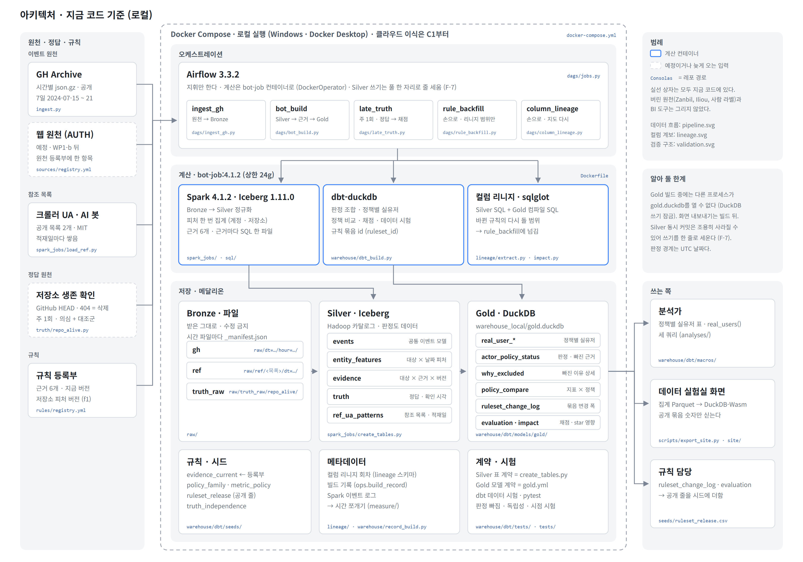

# 봇 프로젝트: 사용자 분석에서 봇을 걸러내는 데이터 플랫폼

[](https://github.com/sozerong/GH/actions/workflows/ci.yml)

봇 판정을 원본 데이터에 굽지 않고, 판정의 [근거](docs/glossary.md#문제와-판정)와 규칙 버전과 함께 따로 둔다. 그래서 규칙이 바뀌어도 분석가 숫자는 공개한 [규칙 묶음](docs/glossary.md#규칙의-버전)에 고정되고, 무엇이 얼마나 바뀌었는지는 다시 계산해 보여 준다.

## 왜 필요한가

회사가 사용자 행동을 분석할 때 봇은 노이즈다. 봇이 섞이면 지표가 틀리고, 지표가 틀리면 결정이 틀린다. 이 플랫폼은 여러 원천의 데이터에서 봇을 한 층([봇 신호 레이어](docs/glossary.md#문제와-판정))에서 걸러, 분석가가 지표마다 믿을 수 있는 [실유저](docs/glossary.md#문제와-판정) 숫자를 직접 골라 바로 가져가게 한다. 지금 원천은 둘이다: GitHub 공개 이벤트(GH Archive)와 웹 로그(도서관 웹 로그 AUTH, 2018년 한 달).

GitHub 7일(2024-07-15 ~ 21)에서 잰 숫자 둘:
- 무리 지어 star를 누른 계정을 빼면(정책 [balanced](docs/glossary.md#정책)) [star 상위 100](docs/glossary.md#지표와-실험) 저장소 중 44 ~ 80%가 바뀐다. 이 판정(가짜 star 저장소)은 나중에 확인된 [정답](docs/glossary.md#채점)(저장소 삭제)으로 채점했고, [정밀도](docs/glossary.md#채점)는 92.1%다. ([정책별 변화](docs/measurements.md#m-26), [채점](docs/measurements.md#m-21))
- 스스로 봇이라고 밝힌 계정 하나가 그날 이벤트의 17 ~ 24%를 낸다. 거르지 않으면 계정당 이벤트를 비교하는 반반 실험이 101 ~ 138%보다 작은 차이를 잡지 못한다([MDE](docs/glossary.md#지표와-실험)). 그 계정 하나만 빼도 17 ~ 37%가 된다. ([확정 쿼리](docs/measurements.md#m-36))

반대로 활동 계정 수는 가장 엄격한 정책([strict](docs/glossary.md#정책))으로도 0.55 ~ 0.83%만 줄어든다. 봇이 어느 지표를 흔드는지는 지표마다 다르다. ([정책별 변화](docs/measurements.md#m-26))

지금의 한계: 원천은 GitHub 하나이고, 정답으로 채점된 근거는 조직 계열(무리 지어 star)뿐이다. 자세한 것은 [한계와 다음](#한계와-다음).

## 구조



- **원천**: GH Archive 시간별 파일을 받아 원본([Bronze](docs/glossary.md#데이터-플랫폼))으로 둔다. 원천은 [sources/registry.yml](sources/registry.yml)에 한 항목씩 적고, 적재할 때마다 읽은 줄과 버린 줄을 기록표에 남긴다.
- **계산**: [Spark](docs/glossary.md#데이터-플랫폼)가 원본을 정리된 표([Silver](docs/glossary.md#데이터-플랫폼))로 바꾸고, 계정·저장소 피처를 한 번 집계한 뒤 근거 9개(GitHub 6개, 웹 3개)를 계산한다. 표 형식은 [Iceberg](docs/glossary.md#데이터-플랫폼)다.
- **판정과 분석 표**: [dbt](docs/glossary.md#데이터-플랫폼)가 정책별 실유저, 채점, 정책 비교 표([Gold](docs/glossary.md#데이터-플랫폼))를 [DuckDB](docs/glossary.md#데이터-플랫폼)에 만든다. 규칙 묶음 id를 함께 남긴다.
- **정답**: 일주일에 한 번 의심 저장소와 대조군이 아직 있는지 확인해, 판정 뒤에 알게 된 사실로만 채점한다.
- **운영**: [Airflow](docs/glossary.md#데이터-플랫폼)가 순서를 잡고, 규칙을 바꾸면 [리니지](docs/glossary.md#데이터-플랫폼)로 다시 계산할 범위만 돈다.

흐름은 [pipeline](docs/img/pipeline.png), 컬럼 단위 리니지는 [lineage](docs/img/lineage.png), 채점은 [validation](docs/img/validation.png) 그림에 있다.

## 써 보기

**화면**: [site/index.html](site/index.html). 브라우저 안에서 집계 파일을 읽어 정책을 바꿔 보고 SQL을 돌린다. 집계만 싣고 계정 이름은 싣지 않는다. 공개 주소: (자리, 배포 뒤 채움). 로컬에서는 `python -m http.server 8000 --directory site`로 연다.

**원하는 요구사항은 이슈로**: [요구사항 양식](https://github.com/sozerong/GH/issues/new?template=requirement.yml)에 무엇을, 어느 지표, 어느 기간을 적어 주면 화면의 요구사항 카드로 더한다.

**표본 한 줄 실행**: 표본 3,407행(2024-07-15 12시)으로 원본 → Silver → 근거 → Gold → 분석 쿼리 셋까지 Airflow 없이 돈다. 이 PC에서 39 ~ 47초 걸렸다. ([걸린 시간](docs/measurements.md#m-33))

```bash
docker build --target bot-job -t bot-job:4.1.2 .
```

```bash
docker run --rm -v "$(pwd):/work" bot-job:4.1.2 python -m scripts.demo
```

Windows Git Bash에서는 앞에 `MSYS_NO_PATHCONV=1`을 붙이고 `$(pwd)` 대신 `$(pwd -W)`를 쓴다. `docker compose`는 Airflow 비밀값 파일(.env)이 없으면 멈추니, 새로 받은 레포에서는 위처럼 `docker run`을 쓴다. ([오류 기록](docs/failure_analysis.md))

## 가져가는 법

분석가는 정책을 고르지 않아도 된다. 지표마다 [기본 정책](docs/glossary.md#정책)이 [warehouse/dbt/seeds/metric_policy.csv](warehouse/dbt/seeds/metric_policy.csv)에 정해져 있다. 잣대는 정답으로 채점된 balanced다. 그래서 활동 계정과 이벤트 수는 lenient, 계정당 이벤트와 star 상위 100은 balanced가 기본이다. ([결정 기록](docs/decisions.md))

- **표면 셋**: `actor_policy_status`(대상 × 날짜 × 정책 → 실유저인가, 빠지게 한 근거, 규칙 묶음 id), `why_excluded`(빠진 대상의 근거, 규칙 버전, 점수, 판정 시각, SQL 지문), `policy_compare_released`(지표 × 정책별 값). 앞의 둘은 컬럼과 형이 바뀌면 빌드가 실패한다.
- **엑셀, 구글 시트, pandas**: 화면의 "가져가기" 탭에서 표를 고르면 파일 주소와 코드가 나온다. 주소는 고정이라 다시 불러오면 가장 최근 데이터를 받는다.
- **strict는 실험 대상 선정에 쓰지 않는다**: strict가 balanced 위에 더 빼는 461 ~ 489개 계정은 모두 그날 이벤트가 100건 이상이다. 결과 지표와 같은 양으로 사람을 빼므로 실험이 치우친다. 보고용 상한으로만 쓴다. ([확정 쿼리](docs/measurements.md#m-36))
- **어느 규칙 묶음의 숫자인가**: `policy_compare_released`와 화면은 공개 묶음([seeds/ruleset_release.csv](warehouse/dbt/seeds/ruleset_release.csv)의 마지막 줄, 지금 `9eff1a5e22a6`)에 고정된다. `actor_policy_status`, `why_excluded`, `real_user_*`는 마지막 빌드의 규칙을 따른다. 규칙 묶음 id는 정책 시드, 근거 SQL, 피처 SQL, 판정 모델을 모두 해시한다.
- dbt 안에서는 매크로 `real_users(policy, source, include_ai_agent=false)`와 `default_policy(metric)`를 쓴다 ([warehouse/dbt/macros/real_users.sql](warehouse/dbt/macros/real_users.sql)). 같은 사람이 GitHub 계정과 웹 클라이언트로 따로 세어지므로 `source`는 꼭 준다.

세 쿼리는 [warehouse/dbt/analyses/](warehouse/dbt/analyses/)에 있고 dbt exposure `analyst_three_queries`로 묶었다. 컴파일한 뒤 돌린다:

```bash
docker compose run --rm bot-job python -m warehouse.dbt_build compile
```

```bash
docker compose run --rm bot-job python -m scripts.query warehouse/dbt/target/compiled/bot_gold/analyses/q1_events_default_policy.sql
```

**① 지표의 기본 정책으로 실유저만** (`q1_events_default_policy.sql`, 지표 `events`의 기본 정책을 시드에서 읽는다). 2026-11-22에 돌린 결과:

| event_date | policy | events |
|---|---|---|
| 2024-07-15 | lenient | 3,527,311 |
| 2024-07-16 | lenient | 3,634,189 |
| 2024-07-17 | lenient | 3,598,334 |
| 2024-07-18 | lenient | 3,539,370 |
| 2024-07-19 | lenient | 3,315,235 |
| 2024-07-20 | lenient | 2,469,829 |
| 2024-07-21 | lenient | 2,515,755 |

**② 이 대상은 왜 빠졌나** (`q2_why_excluded.sql`, 07-15 자기 신고가 아닌 계정 중 한 시간에 가장 많은 저장소에 같은 행동을 한 계정. 이름은 싣지 않는다):

| policy | category | evidence_id | rule_version | score | metrics | judged_at | sql_sha |
|---|---|---|---|---|---|---|---|
| strict | suspected_bot | multi_repo_burst | v2 | 5.9 | {"max_repos_1h":590} | 2026-11-18 01:44:47+00:00 | 6d13d3980700 |

lenient와 balanced에서는 빠지지 않고 strict(행동 계열)에서만 빠진다. 근거 SQL 지문으로 그때 규칙 파일을 찾는다.

**③ 규칙 묶음이 바뀌면 지표가 얼마나 바뀌나** (`q3_ruleset_change.sql`, lockstep_ratio v2 → v3 시험 묶음 `2ce36231097b`, 07-15, 바뀐 것만):

| metric | treatment | base_ruleset | other_ruleset | base_value | other_value | rel_change_pct |
|---|---|---|---|---|---|---|
| active_accounts | balanced | 841ebd6f310f | 2ce36231097b | 656,971 | 656,913 | -0.009 |
| active_accounts | strict | 841ebd6f310f | 2ce36231097b | 656,510 | 656,452 | -0.009 |
| events | balanced | 841ebd6f310f | 2ce36231097b | 3,500,551 | 3,500,367 | -0.005 |
| events | strict | 841ebd6f310f | 2ce36231097b | 3,009,012 | 3,008,828 | -0.006 |
| events_per_account | balanced | 841ebd6f310f | 2ce36231097b | 5.328 | 5.329 | 0.004 |
| events_per_account | strict | 841ebd6f310f | 2ce36231097b | 4.583 | 4.583 | 0.003 |
| repos_flagged | balanced | 841ebd6f310f | 2ce36231097b | 276 | 280 | 1.449 |
| repos_flagged | strict | 841ebd6f310f | 2ce36231097b | 276 | 280 | 1.449 |

실제 출력에는 같은 v3 시험을 옛 id 정의로 만든 묶음 `fdcdcd213e30`의 같은 값 8줄도 나온다. 기본 뷰(`policy_compare_released`)는 [seeds/ruleset_release.csv](warehouse/dbt/seeds/ruleset_release.csv)에 줄을 더해 공개하기 전까지 그 전 공개 묶음 숫자를 그대로 보인다. 지금 공개 묶음은 `841ebd6f310f`(웹 원천을 더한 묶음)이고, GitHub 숫자는 앞 묶음 `9eff1a5e22a6`, 첫 공개 `ad4bfe93bcd9`와 같다([결정 35](docs/decisions.md), [측정 기록](docs/measurements.md#m-32)).

**dbt 밖에서 읽기.** Gold는 파일 하나(`warehouse_local/gold.duckdb`)다. 이미지에 DuckDB CLI는 없고 Python `duckdb`가 있다:

```bash
docker compose run --rm bot-job python -m scripts.query "select policy, count(*) filter (where is_real) as real_accounts, count(*) filter (where not is_real) as excluded from actor_policy_status where source = 'gh' and entity_type = 'gh_account' and event_date = date '2024-07-15' group by policy order by policy"
```

| policy | real_accounts | excluded |
|---|---|---|
| balanced | 656,971 | 3,152 |
| lenient | 658,593 | 1,530 |
| strict | 656,510 | 3,613 |

## 깊이: 병목을 재현하고 고친 기록

- **메모리**: 계정 피처를 만드는 Spark 작업이 한 번에 6.09GiB까지 올라 "큰 머신이 필요하다"고 읽혔다. 컨테이너 상한을 12g에서 2g까지 낮춰 가며 같은 날을 돌려 보니 모두 성공했고, 넘친 데이터를 디스크로 흘리는 일([spill](docs/glossary.md#데이터-플랫폼))은 2g에서만 생겼다. 6.09GiB는 필요량이 아니라 JVM이 받은 만큼 키워 둔 힙이었다. 상한을 4g로 내렸다. ([메모리 측정](docs/measurements.md#m-37))
- **앱 묶기**: 날짜마다 Spark 앱을 하나씩(일주일 63개) 띄우던 것을 작업마다 하나(9개)로 묶었다. 결과는 같고(기준값 329개 중 다름 0), 컨테이너 시간은 1,072초에서 586초로 줄었다. 아낀 몫은 예측한 "앱 띄우는 시간"보다, 같은 JVM을 이어 쓰며 계산 자체가 빨라진 몫이 컸다. ([앱 묶기 측정](docs/measurements.md#m-38))
- **창 넓히기**: 같은 저장소를 함께 star한 계정 쌍을 찾는 자기 조인은 창을 넓히면 터질 것처럼 보인다. 조인 전에 계정마다 C(n,2)를 더해 행 수를 먼저 계산했고, 15일 창 실제 1,140만 행이 계산과 0.33% 안으로 맞았다. 창을 1시간에서 15일로 360배 넓혀도 행은 3.5배, 조인은 6초 안팎 그대로였다. ([창 측정](docs/measurements.md#m-39))

## 한계와 다음

- **원천을 하나 더 붙이는 비용**: 웹 로그 AUTH(요청 409만 줄, 32일)를 붙이는 데 코드 파일 약 30개, 약 600줄, 작업 약 35분이 들었다. Silver 표 계약과 정책·독립성 시드는 0줄이었고, 비용 대부분은 Gold와 시험에 글자로 박혀 있던 GitHub 가정을 푸는 데 들었다. 웹 숫자는 사전 실험과 맞았다(선언 봇 세션 19.1%, 상세 조회 −57%, 전환율 64.9 → 64.8%). 화면은 아직 GitHub만 그린다. ([원천 비용](docs/measurements.md#m-30), [웹 지표](docs/measurements.md#m-32))
- **웹 행동 근거는 채점할 수 없다**: 웹 정답(크롤러 UA 또는 robots.txt)이 자기 신고와 같은 신호라, 신고하지 않는 봇을 잡는 근거(assetless_browser, 66 대상·날짜)는 정밀도를 잴 수 없다. ([웹 근거](docs/measurements.md#m-31))
- **채점된 근거는 조직 계열뿐이다**: 행동 근거(strict가 더 빼는 몫)에는 정답이 없다. 근거 하나씩의 정밀도(49 ~ 99%)도 조합 판정이 고른 표본 안의 값이다. ([근거·정답·정책](docs/criteria.md))
- **같은 이벤트가 두 번 온다**: GH Archive 시간 파일 안에 같은 줄이 하루 1 ~ 12개 들어 있고, 지금은 그대로 센다. 처리 방식은 정하는 중이다. ([오류 기록](docs/failure_analysis.md#f-19))
- **숫자의 범위**: GitHub 숫자는 2024-07-15 ~ 21 7일 값이다(lockstep 창 측정만 15일, [M-39](docs/measurements.md#m-39)). 웹 숫자는 AUTH 2018-02-28 ~ 03-31 값이다. 근거 문턱은 07-15 하루치 사전 실험에서 정했으므로, 07-15 채점은 규칙을 고른 날의 값이다.
- **AI 에이전트 표시**: 웹 원천의 `is_ai_agent`는 User-Agent 문자열만 본다. UA는 꾸밀 수 있어서, 에이전트가 서명으로 자기를 밝히는 방식([RFC 9421](https://www.rfc-editor.org/rfc/rfc9421))이 퍼지면 약해진다. GitHub 원천에는 UA가 없다.

## 문서 지도

| 누가 | 무엇을 읽나 |
|---|---|
| 처음 보는 사람 | [용어집](docs/glossary.md), 이 README |
| 분석가 | [데이터 모델(표와 컬럼)](docs/data_model.md), [근거·정답·정책](docs/criteria.md), 화면 |
| 엔지니어 | [설계 개요](docs/design_overview.md), [엔진 선택](docs/engine_selection.md), [장애 대응](docs/runbook.md), [성질 시험](docs/guarantees.md) |
| 숫자를 따라가는 사람 | [측정 기록](docs/measurements.md)(맨 위에 먼저 볼 측정 5개), [결정 기록](docs/decisions.md), [오류 기록](docs/failure_analysis.md) |
| 클라우드로 옮길 때 | [시간·비용 예측](docs/c1_forecast.md), [구현 순서](docs/implementation_design.md) |

사전 실험은 [experiments/p0_bot_detection/REPORT.md](experiments/p0_bot_detection/REPORT.md), 이전 설계(가짜 star 한정, v0.3)는 [GH_PROJECT_DESIGN.md](GH_PROJECT_DESIGN.md)에 있다. 작업 지시서와 설계 초안은 공개하지 않는다. 기록 문서의 근거 줄이 그 파일을 가리키면 작업 당시의 근거다.

## 로컬에서 돌리기

Windows 데스크톱과 Docker Desktop(메모리 32GB 이상 권장, Spark 컨테이너 상한 24GB)을 기준으로 적었다. 명령은 레포 폴더에서 Git Bash로 친다.

### 1. 준비 (처음 한 번)

`.env`를 만든다 (git에 들어가지 않는다). 값은 이 PC에서만 쓰는 개발용으로 새로 만든다.

```bash
cat > .env <<EOF2
POSTGRES_PASSWORD=$(python -c "import secrets; print(secrets.token_urlsafe(16))")
AIRFLOW_FERNET_KEY=$(python -c "import base64, os; print(base64.urlsafe_b64encode(os.urandom(32)).decode())")
AIRFLOW_JWT_SECRET=$(python -c "import secrets; print(secrets.token_urlsafe(32))")
HOST_PROJECT_DIR=$(pwd -W)
EOF2
```

이미지 두 개(계산용 bot-job, Airflow)를 만들고 Airflow를 띄운다.

```bash
docker compose --profile jobs build
```

```bash
docker compose up -d
```

화면: http://127.0.0.1:8081 (로그인 없이 관리자). DAG 다섯 개가 보인다. `airflow-init`이 DB 준비와 함께 Silver 쓰기 풀 `silver_write`(자리 1개)를 만든다. Silver Iceberg 표에 쓰는 태스크는 이 풀로 하나씩 돈다 ([결정 기록](docs/decisions.md)).

### 2. 일주일치를 처음부터 끝까지

`ingest_gh`를 켜면 2024-07-15 ~ 07-21을 하루씩 받고(catchup), 하루를 다 받을 때마다 `bot_build`가 그날 Silver, 근거, Gold를 만든다.

```bash
docker compose exec airflow-scheduler airflow dags unpause bot_build
```

```bash
docker compose exec airflow-scheduler airflow dags unpause ingest_gh
```

결과: Silver Iceberg 표는 `warehouse_local/silver/`, Gold는 `warehouse_local/gold.duckdb`. 분석팀 표는 `main.real_user_lenient`, `main.real_user_balanced`, `main.real_user_strict`, `main.impact`, 채점은 `main.evaluation`.

### 3. 정답과 채점

`late_truth`는 주 1회 저장소 생존을 확인해 정답을 더하고 채점을 다시 만든다. 손으로 돌릴 때:

```bash
docker compose exec airflow-scheduler airflow dags trigger late_truth -c '{"days": "2024-07-15"}'
```

생존 확인은 이미 성공한 대상을 다시 묻지 않고(`--only-missing`), GitHub가 429로 막으면 모두 같이 쉬며, 확인 실패가 5%를 넘으면 태스크가 실패한다 ([결정 기록](docs/decisions.md)). 실패로 끝나면 같은 명령을 다시 돌리면 빈 것만 묻는다.

채점은 정답을 고른 판정 구간(`days`의 날짜)의 판정과만 짝짓는다. `main.evaluation`은 구간마다 한 행과 전체 행(`window_end`가 비어 있음)을 낸다 ([결정 기록](docs/decisions.md)). 판정보다 뒤에 확인한 정답만 채점에 쓴다. 같은 규칙으로 다시 돌린 근거는 옛 판정 시각을 이어받아 채점이 그대로다. 규칙을 바꾼 날에는 다음 정답 확인 전까지 새 버전의 채점이 빈다 ([결정 기록](docs/decisions.md)).

### 4. 규칙을 바꿨을 때

1. 새 버전 SQL을 더한다 (예: `sql/evidence/lockstep_ratio/v3.sql`). `rules/registry.yml`의 `current`를 바꾼다 (근거 규칙, 또는 저장소 피처 `features_repo`). `bot_build`는 registry를 읽으므로 다음 날짜부터 새 버전을 돈다. 새 근거를 더할 때는 registry 한 줄에 Gold `evidence_flags`와 판정식을 더한다 ([측정 기록](docs/measurements.md)).
2. 리니지 지도를 다시 만든다. 영향 범위 보고서는 registry에서도 출발해 시드와 그 아래를 넣고, Gold 모델은 `gold.yml`의 meta 근거 계열로 좁힌다 ([결정 기록](docs/decisions.md)). registry만 바꿨으면 `lineage.impact --change rules/registry.yml`.

```bash
docker compose exec airflow-scheduler airflow dags trigger column_lineage
```

3. 바뀐 범위만 다시 돌린다.

```bash
docker compose exec airflow-scheduler airflow dags trigger rule_backfill -c '{"change": "sql/evidence/lockstep_ratio/v3.sql", "days": "2024-07-15 2024-07-16"}'
```

### 5. 손으로 한 단계씩 (Airflow 없이)

```bash
docker compose run --rm bot-job python -m spark_jobs.create_tables
```

```bash
docker compose run --rm bot-job python -m spark_jobs.load_events --input raw/dt=2024-07-15 --param window_start=2024-07-15 --param window_end=2024-07-15 --param run_id=manual-1
```

```bash
docker compose run --rm bot-job python -m warehouse.dbt_build
```

적재는 그날 파일에 다른 날짜 이벤트가 한 줄이라도 있으면 쓰기 전에 멈춘다. 쓰면 그 날짜 파티션을 덮어쓰기 때문이다 (sources/registry.yml `late_data: reject`, [결정 기록](docs/decisions.md)).

참조 목록(크롤러 UA, AI 봇)은 받은 날짜별로 쌓는다. 받기는 바깥 요청이다:

```bash
docker compose run --rm bot-job python -m spark_jobs.load_ref fetch
```

```bash
docker compose run --rm bot-job python -m spark_jobs.load_ref load --day 2026-11-22
```

측정 (bot-job 안):

```bash
docker compose run --rm bot-job python -m measure.table_digest --day 2024-07-15
```

```bash
python -m measure.spark_eventlog --app features_repo
```

첫째는 그날 Silver 표 내용 지문(`--table`, `--snapshots A B`로 두 스냅샷 비교), 둘째는 Spark 이벤트 로그(`spark-events/`)에서 스테이지별 태스크 시간과 셔플(호스트 Python으로도 돈다).

시험. 방언 시험(`tests/test_gold_dialect.py`)은 dbt 컴파일 결과를 읽는다. 새로 받은 레포에는 `warehouse_local/`이 없어서(git 제외) 컴파일이 `gold.duckdb`를 만들지 못하고 실패하니 폴더부터 만든다. 컴파일을 건너뛰면 방언 시험이 조용히 건너뛰어진다(skip).

```bash
mkdir -p warehouse_local
```

```bash
docker compose run --rm bot-job python -m warehouse.dbt_build compile
```

```bash
docker compose run --rm bot-job python -m pytest tests -q
```

기대: 51개 모두 통과, 약 2분(2026-11-22, 116초). 판정 빠짐 시험이 실제로 빨개지는지 보는 `tests/test_judged_red.py`가 표본으로 Gold를 세 번 만든다 ([오류 기록](docs/failure_analysis.md#f-18)).

### 알려진 문제

미해결 오류는 [docs/failure_analysis.md](docs/failure_analysis.md)에 있다. 로컬에서 돌릴 때 부딪히는 것:
- GH Archive 시간 파일 안에 같은 이벤트가 두 번 든 줄이 하루 1 ~ 12개 있고, 지금은 그대로 센다 (처리 방식은 정하는 중, [오류 기록](docs/failure_analysis.md#f-19)).
- Silver 표는 Iceberg Hadoop 카탈로그라 동시 커밋이 서로를 덮을 수 있다. 그래서 Airflow 풀로 줄 세우고 실행기가 쓴 뒤 확인한다 ([오류 기록](docs/failure_analysis.md)). Airflow 밖에서 손으로 여러 작업을 동시에 돌리지 않는다.
