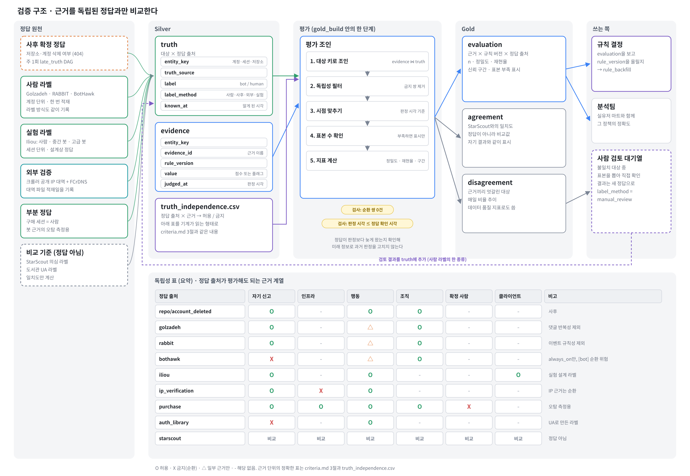
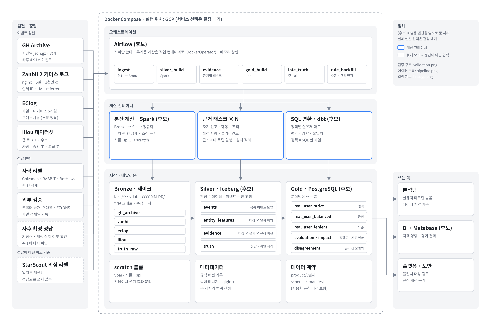
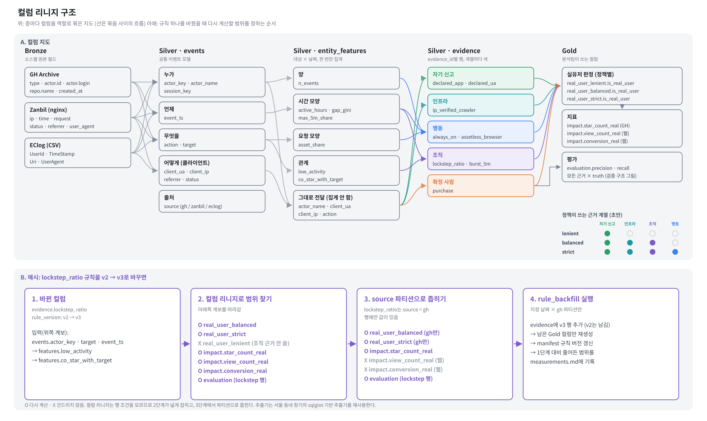
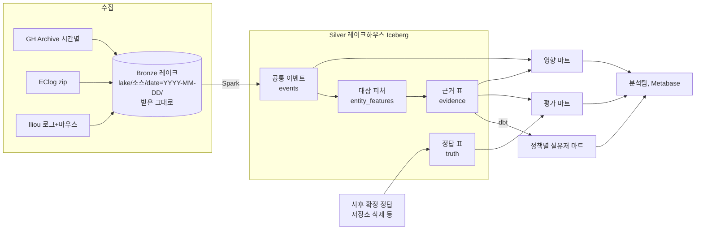
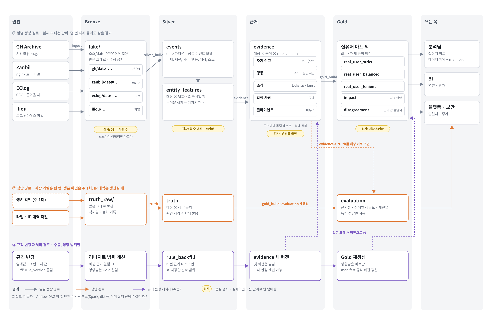

# 봇 프로젝트 전체 구조 설계

상태: 초안 (2026-11-16). 큰 그림만 정한 문서다. 표 스키마, 임계값, 도구 버전 같은 세부는 14절 "열린 결정"의 순서대로 하나씩 정하고 `docs/decisions.md`에 남긴다.

## 0. 한 줄 요약

AI 봇이 섞인 사용자 행동 데이터에서 **판정은 바뀌어도 원본은 잃지 않는** 파이프라인을 만들고, 분석팀에는 **실유저 마트**를 준다. 봇 판정 기준은 여러 근거로 나누고, 근거마다 독립적인 정답과 비교해 정확도를 잰다.

## 1. 문제 정의

> AI 봇 트래픽이 사람 트래픽을 따라잡으면서, 회사가 사용자 행동 데이터로 내리는 결정(상품, 마케팅, 추천)이 사람이 아닌 트래픽에 오염되고 있다.

- Cloudflare Radar 기준 2026년 6월, HTML 요청의 57.5%가 자동화 트래픽이었다. 다만 전체 HTTP 요청 기준으로는 2026년 3분기 35.49%다. 측정 기준을 함께 적는다.
- 사람 대신 행동하는 에이전트형 AI 트래픽은 1년 새 7,851% 늘었다 (HUMAN Security 2026).
- 이 레포의 사전 실험(REPORT.md)에서 확인한 것:
  - GH Archive 하루치에서 가짜 star 의심 저장소 276개가 그날 star의 12.1%를 차지했다. 사후 검증 결과 의심 저장소의 95.3%가 삭제됐다 (대조군 3.6%).
  - 도서관 검색 로그에서 선언 봇이 상세 페이지 조회수의 57%를 만들었다. 반면 검색 후 상세 전환율은 거의 변하지 않았다. **봇이 어떤 지표를 망가뜨리는지는 봇의 움직임에 달려 있다.**

**AI 봇이라서 새로 생기는 문제:** 사람 대신 쇼핑하는 AI 에이전트는 행동은 기계지만 의도는 사람의 수요다. "거른다"로는 답이 안 되므로 별도 범주로 둔다.

## 2. 해결 그림과 범위

**해결 그림:** 파이프라인 안에서 봇을 판정하고, 분석팀에는 현재 규칙 기준 실유저만 담긴 마트를 준다. 그 아래에 원본과 판정을 남겨 규칙이 바뀌면 다시 만든다.

**하는 것**
- 여러 소스를 공통 이벤트 모델로 모으기
- 근거별 판정, 정책별 실유저 마트
- 근거마다 독립적인 정답으로 평가
- 규칙이 바뀔 때 영향 범위만 재처리
- Spark 엔진 수준의 병목 진단

**하지 않는 것**
- 실시간 차단 (WAF, CDN의 일)
- 클라이언트 수집 SDK 개발 (공개 데이터셋의 마우스 데이터로 대신함)
- 봇 탐지 모델의 정확도 경쟁 (탐지 로직은 꽂아 쓰는 부품이고, 본체는 플랫폼이다)

## 3. 설계 원칙

서울 동네 찾기의 원칙 다섯 가지를 그대로 가져오고, 이 프로젝트에 맞는 두 가지를 더한다.

1. **계속 들어오는 실제 입력.** 생성 데이터는 정답 만들기(13절 5단계) 말고는 쓰지 않는다.
2. **처리 단위가 있다.** 이벤트 날짜 파티션 단위로 처리하고, 몇 번 다시 돌려도 결과가 같다 (멱등).
3. **결과를 쓰는 쪽이 있다.** 쓰는 곳이 없는 표는 만들지 않는다.
4. **실패는 드러나야 한다.** 0건, 스키마 변경, 봇 비율 급변은 실패나 경보로 처리한다.
5. **도구마다 규모와 용도로 이유를 댄다.**
6. **(신규) 판정은 데이터다.** 판정은 이벤트를 고치거나 지우지 않는다. 별도 표에 규칙 버전과 함께 쌓는다.
7. **(신규) 정답은 독립적이어야 한다.** 근거를 평가할 때는 그 근거로 만들지 않은 정답만 쓴다. 예를 들어 UA 기준을 UA로 만든 라벨과 비교하지 않는다.

**자주 바뀌는 것과 안 바뀌는 것**

| 자주 바뀜 | 거의 안 바뀜 |
|---|---|
| 판정 규칙(임계값, 조합), 늦게 도착하는 정답, 소스 추가 | 원본 이벤트, 공통 이벤트 모델, 근거 표의 형태 |

## 4. 범주 정의

| 범주 | 뜻 | 실유저 마트 |
|---|---|---|
| human | 사람 | 포함 |
| declared_bot | 스스로 봇이라고 밝힘 (UA, `[bot]`, robots.txt) | 제외 |
| ai_agent | 사람 대신 행동하는 AI (AI 어시스턴트 UA 등) | 별도 표시, 정책에 따라 포함 여부 결정 |
| suspected_bot | 근거상 봇으로 의심 | 정책에 따라 제외 |
| unknown | 근거 부족 | 정책에 따라 결정 |

## 5. 근거 체계와 검증

자세한 내용은 `criteria.md`에 있다. 데이터별 판정 기준 조사, 근거 목록(`evidence_id` 14개), 정답 목록과 독립성 표, 정책 초안이 들어 있다.

| 근거 계열 | 예 | 강도 |
|---|---|---|
| 자기 신고 | `[bot]`, UA 목록, robots.txt, AI 에이전트 UA | 정밀도 높음, 위장 봇은 못 잡음 |
| 인프라 | 크롤러 공개 IP 대역 + FCrDNS, 클라우드 IP | 강함 (IP가 있는 소스만) |
| 행동 | 24시간 활동, 이벤트 규칙성, 댓글 반복성, CSS/JS 미로딩 | 추정 |
| 조직 | lockstep 비율, 5분 burst | 조작형 봇에 강함 |
| 확정 사람 | 구매 | 사람 쪽만 확정 |
| 클라이언트 | 마우스 궤적 | 위장 봇에 강함, 데이터 작음 |

**검증 구조:** 근거는 그 근거로 만들지 않은 정답과만 비교한다. 예를 들어 BotHawk 라벨로 `[bot]` 근거를 평가하지 않고, 도서관 UA 라벨로 UA 근거를 평가하지 않는다. 판정 시각 이후에 알게 된 정답으로 과거 판정을 고치지도 않는다.

정답이 없는 곳에서는 **근거끼리 엇갈리는 비율**을 매일 잰다. 엇갈린 대상에서 표본을 뽑아 사람이 확인하고, 그 결과를 `manual_review` 정답으로 truth에 다시 넣는다.

## 6. 데이터 소스

| 소스 | 역할 | 규모 | 비고 |
|---|---|---|---|
| GH Archive | **본체.** Spark 규모, 조직형 봇, 사후 확정 정답(저장소 삭제) | 하루치 압축 2.6GB, 4.91M 이벤트 (2024-07-15, 측정). 한 달치는 받아서 측정 예정 | 시간별 json.gz, 공개 |
| EClog | 실제 이커머스 로그, 구매 기반 부분 정답 | zip 약 600MB, 2019-11-30 ~ 2020-05-31 | Harvard Dataverse, 접근 제한 없음 확인 |
| Iliou Web Bot Detection | 위장 봇 정답, 클라이언트 근거 평가 | 단계마다 사람 세션 50~56개, 같은 수의 봇 세션 | CC BY-NC-SA, 웹 로그 + 마우스 |
| Zanbil 이커머스 로그 | 웹 쪽 본체. 실제 IP가 있어 인프라 근거와 IP 검증 가능 | 2019-01-22 ~ 26, 1천만 건 이상, 3.5GB | Kaggle (로그인 필요). Harvard 원본은 접근 제한 |
| 도서관 로그 (선택) | 사전 실험 재현용 | 409만 요청 | Zenodo 3477932, CC BY 4.0 |

**정답 데이터**

| 데이터 | 내용 | 비고 |
|---|---|---|
| Golzadeh | 계정 5,000개 (봇 527), 사람 3명 판정 | Zenodo 4000388, CC BY 4.0 |
| RABBIT | 계정 1,335개 (봇 644), 연구자 판정 (κ = 0.79) | MSR 2024 |
| BotHawk | 계정 19,778개 (봇 755), `actor_id` 있음 | Zenodo 13118001. 라벨 검증 정보 없음 |
| StarScout | 가짜 star 의심 (비교용) | Zenodo 17009694, CC BY 4.0, 5.6GB |
| 크롤러 IP 대역 | 운영사가 공개한 크롤러 대역 파일 | 적재일 기록, 로그 시점과 차이 주의 |

## 7. 전체 구조

엔진 이름 뒤의 (후보)는 범용 엔진을 임시로 둔 자리다. 실제 선택은 서울 동네 찾기 때처럼 참고 사례와 실측으로 따로 정한다.

컬럼 단위 계보는 아래 그림이다. 규칙 하나를 바꿨을 때 어디까지 다시 계산해야 하는지를 이 계보로 정한다.

데이터가 층을 지나는 흐름은 아래와 같다.

### 7.1 Bronze
- 서울 동네 찾기의 레이크 규칙을 그대로 쓴다. 소스별, 날짜별 폴더에 받은 그대로 두고 절대 고치지 않는다.
- 소스마다 받는 부분(어댑터)만 다르다. 새 소스가 생기면 어댑터 하나만 추가한다.

### 7.2 Silver
| 표 | 한 행 | 하는 일 |
|---|---|---|
| events | 이벤트 하나 | 소스가 달라도 같은 모양: 주체, 세션, 시각, 행동, 대상, 클라이언트 정보, 소스 |
| entity_features | 대상(계정 또는 세션) × 날짜 | 무거운 집계를 **한 번만** 한다 (Spark) |
| evidence | 대상 × 근거 × 규칙 버전 | 근거마다 독립 작업이 같은 표에 쓴다. 세로로 긴 형태라 근거를 추가해도 표 구조가 안 바뀐다 |
| truth | 대상 × 정답 출처 | 확인 시각(언제 알게 됐나)을 함께 쌓는다 |

이벤트 시각과 판정 시각을 따로 둔다. 2년 뒤 삭제가 확인돼도 "그 시점의 판정이 맞았나"를 다시 볼 수 있어야 한다.

### 7.3 Gold
| 마트 | 받는 쪽 | 내용 |
|---|---|---|
| real_user_* (정책별: strict, balanced, lenient) | 분석팀 | 현재 규칙 기준 실유저만 |
| evaluation | 플랫폼, 분석팀 | 근거별, 정책별 정밀도·재현율 (독립 정답만 사용) |
| impact | 분석팀 | 정책별로 지표(조회수, 전환율, 인기 순위)가 얼마나 달라지나 |
| disagreement | 플랫폼 | 근거끼리 엇갈린 대상과 비율 추이 |

분석팀에 넘길 때는 서울 동네 찾기처럼 **데이터 계약**(스키마 파일 + manifest)을 붙인다. manifest에는 사용한 규칙 버전을 적는다.

## 8. 실행 구조

서울 동네 찾기의 실행 구조를 가져온다.
- **Docker Compose:** Airflow 구성 요소를 각각의 컨테이너로 나누고(apiserver, scheduler, dag-processor, triggerer), 무거운 계산은 DockerOperator로 작업마다 메모리 상한을 건 계산 컨테이너(spark-job, duckdb-job)에서 돌린다. 스케줄러 시작 시 주인 없는 계산 컨테이너를 멈춘다.
- **저장 (로컬 초안):** Bronze는 파일, Silver는 Iceberg, Gold는 PostgreSQL + dbt, 조회는 Metabase. GCP에서는 `engine_selection.md` 2절 표로 바뀐다 (Gold는 BigQuery + dbt-bigquery 추천).

파이프라인 관점(데이터가 어떤 경로로 흐르고, 언제 다시 도는가)은 아래 그림이다. 일별 정상 경로, 정답 경로, 규칙 변경 재처리 경로 세 가지로 나눴다.

**사후 확정 정답이란:** 판정을 내린 시점에는 아직 없고, 시간이 지나야 생기는 정답이다. 카드 결제를 예로 들면, 결제 순간에는 사기인지 알 수 없고 몇 주 뒤 고객이 이의를 제기해야 사기로 확정된다. 이 프로젝트에서는 저장소가 나중에 삭제되는 경우가 그렇다. 2024-07-15에 "35초 만에 별 65개"로 의심 판정을 받은 저장소가 몇 달 뒤 GitHub에서 지워지면, 그때 비로소 실제로 악성이었다고 확정된다. 그래서 (1) 주 1회 다시 확인하는 작업(late_truth DAG)이 필요하고, (2) 정답 표에 "이 사실을 언제 알게 됐는지"(known_at)를 함께 남기며, (3) 평가할 때 판정 당시 알 수 없던 정보로 판정을 고쳐 쓰지 않는다. 사람이 미리 붙여 둔 라벨(Golzadeh, Iliou)은 데이터를 받는 순간 이미 있으므로 여기에 해당하지 않는다.

**DAG (초안)**
| DAG | 주기 | 하는 일 |
|---|---|---|
| ingest_gh | 시간별 또는 일별 | GH Archive 받기 → Bronze |
| ingest_files | 파일이 들어올 때 (센서) | EClog, Iliou → Bronze |
| silver_build | Bronze 갱신 시 (Asset) | events, entity_features (Spark) |
| evidence | silver_build 뒤 | 근거마다 태스크 하나. 하나가 실패해도 나머지는 진행 |
| gold_build | evidence 뒤 | dbt로 정책 마트, 평가, 영향, 불일치 |
| late_truth | 주 1회 | 저장소 생존 확인 등 사후 확정 정답 갱신 → 평가 마트 |
| rule_backfill | 수동 (규칙 버전 변경 시) | 바뀐 근거 태스크와 그 하위 Gold만 재실행 |

## 9. 변화 대응

| 변화 | 고치는 곳 | 다시 도는 곳 |
|---|---|---|
| 규칙 임계값, 조합 변경 | 정책 SQL 또는 근거 태스크 하나 | 해당 근거와 그 하위 Gold (컬럼 리니지로 범위 산정) |
| 새 근거 추가 | 근거 태스크 하나 + 정책 SQL | 새 근거 계산, 정책 마트 |
| 사후 확정 정답 도착 | 없음 | 평가 마트 |
| 새 소스 추가 | Bronze 어댑터 + events 매핑 | 그 소스의 Silver 이후 |
| 소스 스키마 변경 | 어댑터만 | 그 소스의 Silver 이후 |

컬럼 리니지는 서울 동네 찾기의 추출기(sqlglot 파싱)를 재사용한다. 그래서 "근거 컬럼 하나가 바뀌면 어떤 실유저 마트 컬럼이 영향받나"를 계산할 수 있다.

## 10. 엔진 깊이 (이 프로젝트의 차별점)

서울 동네 찾기와 겹치지 않게, 여기서는 Spark 내부 동작을 판다. 문제는 미리 정하지 않고 실제로 생긴 것만 `docs/failure_analysis.md`에 원인까지 기록한다. 아래는 사전 실험에서 이미 징후가 보인 후보다.

| 후보 | 사전 실험에서 본 것 | 파 볼 지점 |
|---|---|---|
| lockstep 쌍 계산의 쏠림 | 하루 100개 넘게 star하는 계정 때문에 계정당 50개 상한을 걸었고, 그 상한 때문에 캠페인을 놓쳤다 | 상한 없이 푸는 법 (salting, 2단계 집계, 후보 축소). 셔플 크기, 태스크별 처리 시간 분포 |
| 여러 날 증분 계산 | 하루치로는 나눠 찍는 캠페인을 못 잡았다 | 매일 전체를 다시 도는 방식과 상태를 쌓는 방식의 비용 비교 |
| 이벤트 × 근거 조인 | 아직 없음 | 브로드캐스트 조인과 sort-merge 조인 선택, 파티션 가지치기 |
| Iceberg 파일 배치 | 아직 없음 | 시간별 적재로 생기는 작은 파일 문제, 압축(compaction) 주기 |

## 11. 보증

`docs/guarantees.md` 형식(방법, 근거, 조건, 강도, 한계)을 그대로 쓴다. 먼저 증명할 성질:
1. **멱등:** 같은 날짜 파티션을 다시 돌려도 events, evidence, Gold가 같다.
2. **재현:** 과거 규칙 버전으로 그때의 실유저 마트를 다시 만들 수 있다 (Iceberg 스냅샷 + 규칙 버전).
3. **재처리 범위:** 규칙 하나를 바꿨을 때 리니지가 예측한 범위 밖은 변하지 않는다 (변이 시험).
4. **정답 독립성:** 평가 마트의 각 칸이 순환하지 않는 정답만 쓴다 (5절 표를 기계가 읽는 형태로 두고 검사).

## 12. 서울 동네 찾기에서 가져오는 것

| 가져옴 | 새로 만듦 |
|---|---|
| 설계 원칙 1~5, 레이크 폴더 규칙 | 공통 이벤트 모델 (서로 다른 세 소스) |
| Airflow 지휘·계산 분리, DockerOperator, 메모리 상한, 고아 컨테이너 정리 | 근거 표, 정답 표, 정책별 마트 |
| Iceberg, dbt, Metabase | 평가 마트 (정답 독립성 포함), 불일치 모니터링 |
| sqlglot 컬럼 리니지 추출기 | 규칙 버전 기반 재처리 DAG |
| 데이터 계약 + manifest | 사후 확정 정답 갱신 |
| decisions, measurements, guarantees, failure_analysis 문서 형식 | Spark 쏠림, 증분 계산 진단 |

가져오지 않는 것: SQL 1차 대응 에이전트, 파이프라인 UI. 서울 쪽에서 이미 보여 주므로 여기서는 시간을 쓰지 않는다.

## 13. 단계 계획

순서만 정하고 기간은 정하지 않는다. 각 단계의 세부는 시작할 때 정한다.

| 단계 | 내용 | 끝났다고 보는 기준 |
|---|---|---|
| 0 | 이 문서 확정, 열린 결정 1~3 | 결정 기록 3개 |
| 1 | GH Archive 한 달치 Bronze, Silver events (Spark) | 행 수 대조, 멱등 증명 1건 |
| 2 | entity_features, evidence (사전 실험의 근거를 옮김) | 사전 실험 결과(v3 의심 276개)를 같은 날짜로 재현 |
| 3 | Gold 마트 3종 + 평가 + late_truth | 분석팀용 계약 초안, 평가 마트에서 v1~v3 비교 |
| 4 | Spark 깊이: lockstep 상한 제거, 여러 날 증분 | failure_analysis 기록, 측정 전후 비교 |
| 5 | EClog, Iliou 추가 (두 번째, 세 번째 소스) | 어댑터만 추가로 붙는지 확인, 위장 봇 정답 평가 |
| 6 | (선택) 정답 만들기: 데모 페이지에 수준별 봇을 돌려 라벨 있는 위장 봇 트래픽 생성 | 생성 트래픽의 평가 결과 |

## 14. 열린 결정 (이 순서로 정한다)

1. ~~본체 범위~~ → **결정 1 (2026-11-16):** GCP에서 처음부터 진행. GH Archive 일주일치로 한 경로를 끝까지 돌린 뒤 데이터를 단계적으로 늘린다 (`docs/decisions.md` 결정 1, 2)
   - 남은 세부: Spark 방식, Airflow 위치, 리전 등 엔진 선택은 `docs/engine_selection.md` (E2~E11, 추천안 결정 대기). 그 추천안 기준 구현 순서는 `docs/implementation_design.md`
2. **판정 대상 단위:** 계정 단위만 / 세션 단위 병행 (GH는 계정, 웹 소스는 세션)
3. **공통 이벤트 모델의 최소 필드**
4. evidence 표 형태(세로형 확정 여부)와 규칙 버전 표기 방식
5. 정책 3종의 정의 (어떤 근거를 어떻게 조합하나)
6. Gold 저장 위치 → `engine_selection.md` E9에서 BigQuery + dbt-bigquery 추천
7. 레포 구성 → `implementation_design.md` 2절에서 독립 레포 추천 (리니지만 복사)

## 참고

- 사전 실험 결과: `REPORT.md`
- Cloudflare Radar 관련 집계: https://www.digitalapplied.com/blog/ai-crawler-bot-traffic-statistics-2026-data-reference , https://technologychecker.io/blog/web-traffic-statistics
- HUMAN Security 2026 State of AI Traffic (에이전트형 트래픽 증가): https://theaicareerlab.com/blog/ai-agents-majority-web-traffic-2026
- He et al., 4.5 Million (Suspected) Fake Stars in GitHub (2024): https://arxiv.org/abs/2412.13459
- EClog: https://doi.org/10.7910/DVN/Z834IK
- Iliou et al., Web Bot Detection Dataset: https://m4d.iti.gr/web-bot-detection-dataset/
- Positive-Unlabeled 방식의 사람 확정(구매, CAPTCHA): https://ceur-ws.org/Vol-2758/OHARS-paper4.pdf
- 서울 동네 찾기: https://github.com/sozerong/home_in_seoul
